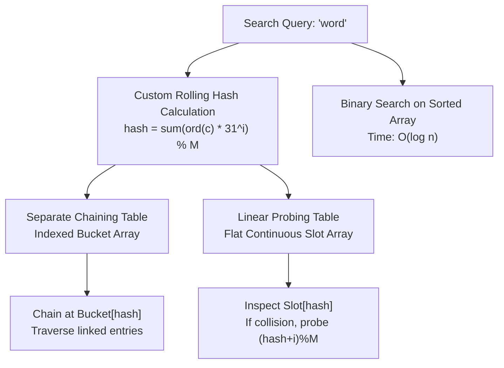
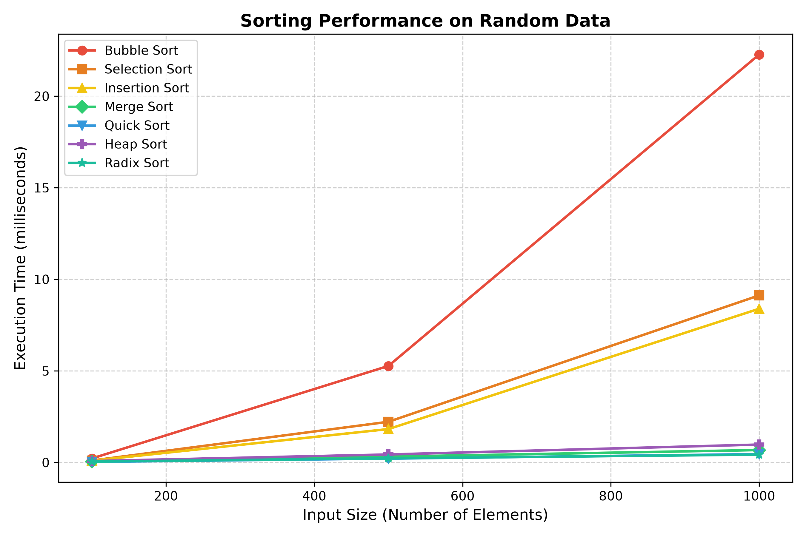
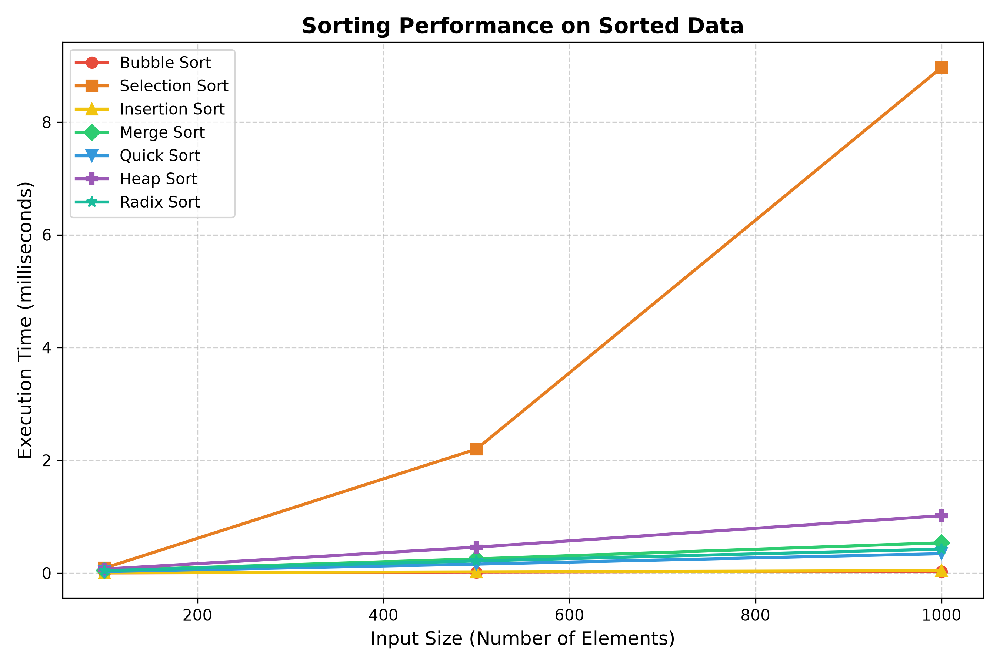
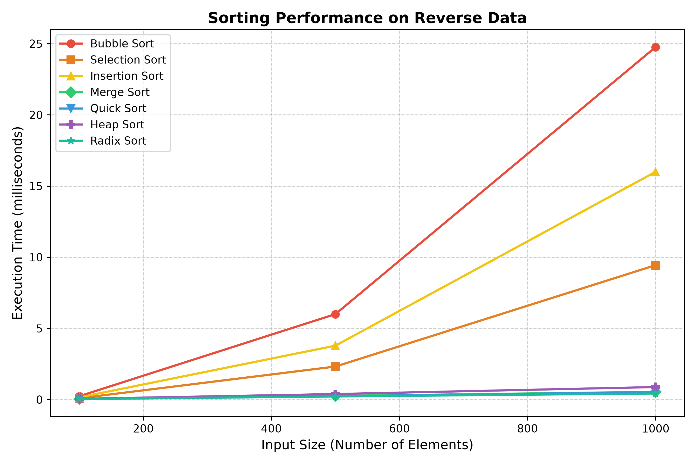
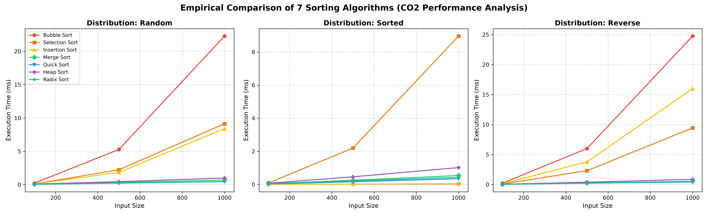

# IC-307D: Data Structures and Algorithms Lab
## Unit 2: Sorting and Searching Algorithms (CO2)

---

## 1. Introduction

Sorting and searching are among the most pervasive algorithmic operations in modern computing. At its core, **sorting** transforms an arbitrary, disordered sequence of keys into a monotonic sequence (typically non-decreasing or non-increasing order). Imposing order on raw data transforms downstream processing: linear searches requiring scan time $O(n)$ become logarithmic bisections requiring $O(\log n)$ time, database indexes can efficiently prune lookup spaces, duplicates can be detected in linear scans, and divide-and-conquer subroutines can operate under predictable structural invariants.

From an algorithmic and theoretical standpoint, sorting algorithms are partitioned into two broad taxonomic classes:

1. **Comparison-Based Sorting Algorithms**:
   These algorithms establish relative order strictly through pairwise key comparisons ($A[i] \le A[j]$). By decision tree modeling, any comparison sort must possess at least $n!$ leaves corresponding to all permutations of $n$ elements. Because a binary tree of height $h$ has at most $2^h$ leaves, $2^h \ge n! \implies h \ge \log_2(n!) = \Omega(n \log n)$ by Stirling's approximation. Consequently, $\Omega(n \log n)$ represents the theoretical information lower bound for worst-case comparisons.
   - **Quadratic Sorting ($O(n^2)$)**: [Bubble Sort](file:///home/jeet/Desktop/Data_structures/Lab02-Sorting-Searching/Program01-BubbleSort/bubble_sort.py), [Selection Sort](file:///home/jeet/Desktop/Data_structures/Lab02-Sorting-Searching/Program02-SelectionSort/selection_sort.py), and [Insertion Sort](file:///home/jeet/Desktop/Data_structures/Lab02-Sorting-Searching/Program03-InsertionSort/insertion_sort.py). Although asymptotically inefficient for massive datasets, they exhibit minimal code footprint, near-zero constant overhead, and in the case of Insertion Sort, optimal $O(n)$ adaptive behavior on nearly-sorted data.
   - **Log-Linear Sorting ($O(n \log n)$)**: [Merge Sort](file:///home/jeet/Desktop/Data_structures/Lab02-Sorting-Searching/Program04-MergeSort/merge_sort.py), [Quick Sort](file:///home/jeet/Desktop/Data_structures/Lab02-Sorting-Searching/Program05-QuickSort/quick_sort.py), and [Heap Sort](file:///home/jeet/Desktop/Data_structures/Lab02-Sorting-Searching/Program06-HeapSort/heap_sort.py). These leverage divide-and-conquer partitioning or complete binary heap trees to attain optimal asymptotic performance.

2. **Non-Comparison Sorting Algorithms**:
   By bypassing pairwise comparisons and instead exploiting the lexical or numeric positional representation of elements (radix, digits, or bits), non-comparison algorithms break through the $\Omega(n \log n)$ barrier. [Radix Sort (Least Significant Digit - LSD)](file:///home/jeet/Desktop/Data_structures/Lab02-Sorting-Searching/Program07-RadixSort/radix_sort.py) uses a stable counting subroutine across each digit place $d$, achieving linear-time complexity $O(d \cdot (n + b))$ for a radix base $b$.

In parallel, **searching algorithms** determine whether a target key exists within a collection, and if so, return its index or associated record:
- **Binary Search**: Operates over ordered contiguous arrays by repeatedly bisecting the active search window, reducing candidate elements by half at each step to deliver deterministic $O(\log n)$ performance.
- **Hashing**: Maps arbitrary keys to bounded array slots using a hash function. When engineered with robust collision resolution mechanisms—such as **Separate Chaining** (linked bucket lists) or **Linear Probing** (open addressing sequential scanning)—hash tables achieve average-case $O(1)$ constant-time lookup and insertion.

This laboratory unit provides a rigorous, from-scratch implementation and empirical investigation of seven sorting algorithms, binary searching, benchmarking suites, and two real-world applied software systems: an in-memory Student Record Manager and a Dictionary Search Engine Simulator.

---

## 2. Aim

To study, design, implement from first principles, empirically benchmark, and analyze the seven core sorting algorithms (Bubble Sort, Selection Sort, Insertion Sort, Merge Sort, Quick Sort, Heap Sort, and LSD Radix Sort), explore both iterative and recursive Binary Search, and build real-world application systems (Student Record Manager and Search Engine Simulator with collision resolution) in Python without using external sorting libraries.

---

## 3. Learning Objectives

Upon successful completion of this laboratory unit, students will be able to:

1. **Implement and Optimize Elementary Quadratic Sorts**:
   - Construct Bubble Sort with early-termination flag tracking to identify pre-sorted arrays in $O(n)$ time.
   - Implement Selection Sort and examine why its comparison count is invariant to initial list permutation.
   - Implement Insertion Sort and verify its adaptive nature on partially sorted sequences.
2. **Master Advanced Divide-and-Conquer and Tree-Based Algorithms**:
   - Construct Merge Sort and analyze its two-way merging logic, auxiliary buffer requirements, and stability guarantee.
   - Implement Quick Sort with median-of-three pivot selection to prevent $O(n^2)$ worst-case degeneration on pre-ordered inputs.
   - Build an in-place Binary Max-Heap from an arbitrary array in $O(n)$ time and implement Heap Sort in $O(n \log n)$ time with $O(1)$ auxiliary space.
3. **Analyze Non-Comparison Sorting**:
   - Implement LSD Radix Sort using stable Counting Sort passes across decimal place values.
   - Validate input constraints and understand domain bounds for integer-based sorting.
4. **Formulate and Compare Search Strategies**:
   - Implement both iterative and recursive Binary Search, analyzing time and call-stack space complexities.
   - Construct a custom polynomial rolling hash function without relying on Python's built-in `hash()`.
   - Implement and contrast Separate Chaining versus Linear Probing for hash collision resolution.
5. **Conduct Empirical Performance Benchmarking**:
   - Design an automated benchmarking harness measuring wall-clock execution time via high-resolution counters (`time.perf_counter()`).
   - Profile algorithms across varying dataset sizes ($N = 100, 500, 1000$) and input orders (Random, Already Sorted, Reverse Sorted).
   - Generate high-resolution Matplotlib performance plots and correlate theoretical big-$O$ complexity with empirical curves.
6. **Engineer Practical Software Systems**:
   - Develop an in-memory Student Record Manager supporting multi-key sorting (Merge Sort for Roll Number and Marks; Quick Sort for Names) and binary search retrieval.
   - Build a Search Engine Simulator comparing sorted array binary search against hash tables under high load and deliberate collision scenarios.

---

## 4. Software Requirements

- **Programming Language**: Python 3.8 or higher (Standard Library)
- **Visualization Library**: Matplotlib 3.3+ (installed for benchmark graph generation)
- **Numerical Library**: NumPy (used exclusively by Matplotlib plotting backend)
- **Operating System**: Linux (Ubuntu / Debian x86_64, POSIX-compliant environment)
- **Execution Shell**: GNU Bash 5.0+
- **Code Standards**: Strictly manual algorithm implementations. Built-in primitives such as `sorted()`, `list.sort()`, `bisect`, or `heapq` are strictly prohibited in algorithm definitions to ensure algorithmic authenticity.

---

## 5. Experiments 1–7: Sorting Algorithms

### 5.1 Experiment 1: Bubble Sort

#### Problem Statement
Sort an arbitrary list of integers in ascending order using Bubble Sort, incorporating an early-termination optimization flag (`swapped`) that halts execution if the array is detected to be already sorted.

#### Approach
Bubble Sort makes multiple sequential passes over an array. In each pass, adjacent elements $A[j]$ and $A[j+1]$ are compared. If $A[j] > A[j+1]$, they are out of order and swapped. This causes larger elements to "bubble up" toward the end of the array. After pass $i$, the $i$-th largest element is guaranteed to occupy its correct terminal position. By tracking whether any swap occurred during a full pass, the algorithm can terminate immediately if no swaps were made, completing in $O(n)$ time for pre-sorted inputs.

#### Algorithm
1. Receive input list $A$ of size $n$. Create a local copy to preserve the original list.
2. If $n \le 1$, return $A$.
3. Outer loop: Iterate pass index $i$ from $0$ to $n - 2$:
   - Initialize boolean flag $\text{swapped} \leftarrow \text{False}$.
   - Inner loop: Iterate comparison index $j$ from $0$ to $n - 2 - i$:
     - If $A[j] > A[j + 1]$:
       - Swap $A[j]$ and $A[j + 1]$.
       - Set $\text{swapped} \leftarrow \text{True}$.
   - If $\text{swapped} == \text{False}$, the array is fully sorted; break the outer loop immediately.
4. Return sorted array $A$.

#### Pseudocode
```text
FUNCTION bubble_sort(A):
    n = length(A)
    IF n <= 1 THEN RETURN A
    
    FOR i FROM 0 TO n - 2 DO:
        swapped = False
        FOR j FROM 0 TO n - 2 - i DO:
            IF A[j] > A[j + 1] THEN:
                SWAP A[j], A[j + 1]
                swapped = True
        IF NOT swapped THEN:
            BREAK
    RETURN A
END FUNCTION
```

#### Dry Run
Given input list: `[64, 34, 25, 12, 22]`, $n = 5$.
- **Pass $i = 0$** ($\text{swapped} = \text{False}$):
  - $j = 0$: Compare $64 > 34 \implies \text{Swap} \to [34, 64, 25, 12, 22]$, $\text{swapped} = \text{True}$
  - $j = 1$: Compare $64 > 25 \implies \text{Swap} \to [34, 25, 64, 12, 22]$, $\text{swapped} = \text{True}$
  - $j = 2$: Compare $64 > 12 \implies \text{Swap} \to [34, 25, 12, 64, 22]$, $\text{swapped} = \text{True}$
  - $j = 3$: Compare $64 > 22 \implies \text{Swap} \to [34, 25, 12, 22, 64]$, $\text{swapped} = \text{True}$
  - *End of pass 0: Element 64 is in its final position.*
- **Pass $i = 1$** ($\text{swapped} = \text{False}$):
  - $j = 0$: Compare $34 > 25 \implies \text{Swap} \to [25, 34, 12, 22, 64]$, $\text{swapped} = \text{True}$
  - $j = 1$: Compare $34 > 12 \implies \text{Swap} \to [25, 12, 34, 22, 64]$, $\text{swapped} = \text{True}$
  - $j = 2$: Compare $34 > 22 \implies \text{Swap} \to [25, 12, 22, 34, 64]$, $\text{swapped} = \text{True}$
  - *End of pass 1: Element 34 is in its final position.*
- **Pass $i = 2$** ($\text{swapped} = \text{False}$):
  - $j = 0$: Compare $25 > 12 \implies \text{Swap} \to [12, 25, 22, 34, 64]$, $\text{swapped} = \text{True}$
  - $j = 1$: Compare $25 > 22 \implies \text{Swap} \to [12, 22, 25, 34, 64]$, $\text{swapped} = \text{True}$
- **Pass $i = 3$** ($\text{swapped} = \text{False}$):
  - $j = 0$: Compare $12 \le 22 \implies \text{No swap}$.
  - Loop finishes with $\text{swapped} == \text{False} \implies$ **Early break**.
- **Final Result**: `[12, 22, 25, 34, 64]`.

#### Complexity Analysis
- **Best-Case Time Complexity**: $O(n)$ — occurs when the array is already sorted. The algorithm executes exactly $n - 1$ comparisons in pass $0$, detects $\text{swapped} == \text{False}$, and breaks early.
- **Average-Case Time Complexity**: $O(n^2)$ — expected comparisons: $\sum_{i=0}^{n-2} (n - 1 - i) \approx n^2 / 2$; expected swaps: $\approx n^2 / 4$.
- **Worst-Case Time Complexity**: $O(n^2)$ — occurs when input is reverse-sorted. Performs $n(n-1)/2$ comparisons and $n(n-1)/2$ swaps.
- **Auxiliary Space Complexity**: $O(1)$ — sorts in-place using a single swap temporary variable.
- **Stability**: **Stable** — adjacent elements are swapped only when strictly greater ($A[j] > A[j+1]$), preserving original order of identical elements.

#### Real-Life Application
- Embedded microcontroller firmware and educational computer graphics pipelines where code footprint must be minimal ($<10$ lines of machine assembly) and input sequences arrive nearly pre-sorted with occasional out-of-order sensor readings.

---

### 5.2 Experiment 2: Selection Sort

#### Problem Statement
Sort an arbitrary list of integers in ascending order using Selection Sort by repeatedly locating the absolute minimum value from the unsorted suffix and swapping it to the boundary of the sorted prefix.

#### Approach
Selection Sort divides the array logically into a sorted prefix $A[0 \dots i-1]$ and an unsorted suffix $A[i \dots n-1]$. In each iteration, it performs a linear scan over the unsorted suffix, records the index of the minimum element, and executes a single swap placing that minimum element at index $i$. By restricting swaps to at most $n - 1$ total operations, Selection Sort minimizes the number of memory write operations.

#### Algorithm
1. Receive input list $A$ of size $n$.
2. If $n \le 1$, return $A$.
3. For $i$ from $0$ to $n - 2$:
   - Assume index $i$ holds the current minimum: $\text{min\_idx} \leftarrow i$.
   - For $j$ from $i + 1$ to $n - 1$:
     - If $A[j] < A[\text{min\_idx}]$, update $\text{min\_idx} \leftarrow j$.
   - If $\text{min\_idx} \neq i$:
     - Swap $A[i]$ and $A[\text{min\_idx}]$.
4. Return sorted array $A$.

#### Pseudocode
```text
FUNCTION selection_sort(A):
    n = length(A)
    IF n <= 1 THEN RETURN A
    
    FOR i FROM 0 TO n - 2 DO:
        min_idx = i
        FOR j FROM i + 1 TO n - 1 DO:
            IF A[j] < A[min_idx] THEN:
                min_idx = j
        IF min_idx != i THEN:
            SWAP A[i], A[min_idx]
    RETURN A
END FUNCTION
```

#### Dry Run
Given input list: `[29, 10, 14, 37, 13]`, $n = 5$.
- **Iteration $i = 0$**: Suffix is `[29, 10, 14, 37, 13]`, $\text{min\_idx} = 0$.
  - $j = 1: 10 < 29 \implies \text{min\_idx} = 1$
  - $j = 2: 14 \not< 10 \implies \text{min\_idx} = 1$
  - $j = 3: 37 \not< 10 \implies \text{min\_idx} = 1$
  - $j = 4: 13 \not< 10 \implies \text{min\_idx} = 1$
  - Swap $A[0] \leftrightarrow A[1] \implies [10, 29, 14, 37, 13]$.
- **Iteration $i = 1$**: Suffix is `[29, 14, 37, 13]`, $\text{min\_idx} = 1$.
  - $j = 2: 14 < 29 \implies \text{min\_idx} = 2$
  - $j = 3: 37 \not< 14 \implies \text{min\_idx} = 2$
  - $j = 4: 13 < 14 \implies \text{min\_idx} = 4$
  - Swap $A[1] \leftrightarrow A[4] \implies [10, 13, 14, 37, 29]$.
- **Iteration $i = 2$**: Suffix is `[14, 37, 29]`, $\text{min\_idx} = 2$.
  - Minimum is already $14$ at index 2 ($\text{min\_idx} == i$, no swap).
- **Iteration $i = 3$**: Suffix is `[37, 29]`, $\text{min\_idx} = 3$.
  - $j = 4: 29 < 37 \implies \text{min\_idx} = 4$
  - Swap $A[3] \leftrightarrow A[4] \implies [10, 13, 14, 29, 37]$.
- **Final Result**: `[10, 13, 14, 29, 37]`.

#### Complexity Analysis
- **Best-Case Time Complexity**: $O(n^2)$ — the inner loop executes unconditionally for all pairs, totaling $n(n-1)/2$ comparisons even if the list is already sorted.
- **Average-Case Time Complexity**: $O(n^2)$ comparisons, $O(n)$ swaps.
- **Worst-Case Time Complexity**: $O(n^2)$ comparisons, $n - 1$ swaps.
- **Auxiliary Space Complexity**: $O(1)$ — in-place memory modification.
- **Stability**: **Unstable** — long-range swaps can jump equal elements across one another (e.g., sorting `[2a, 2b, 1]` swaps `2a` with `1`, placing `2a` after `2b`).

#### Real-Life Application
- Flash memory, EEPROM storage, and solid-state space systems where physical memory write cycles degrade device lifespan, making algorithms that strictly bound writes to $O(n)$ swaps preferable over high-write algorithms.

---

### 5.3 Experiment 3: Insertion Sort

#### Problem Statement
Sort an arbitrary list of integers in ascending order using Insertion Sort by sequentially inserting each unsorted element into its proper position within the pre-existing sorted prefix.

#### Approach
Insertion Sort mirrors how human card players arrange playing cards in hand. The array is conceptually split into a sorted prefix ($A[0 \dots i-1]$) and an unsorted suffix ($A[i \dots n-1]$). Starting at index $1$, each element (`key`) is compared right-to-left against the sorted prefix. All elements strictly greater than the `key` are shifted one position to the right. Once the proper insertion location is found, the `key` is dropped into place.

#### Algorithm
1. Receive input list $A$ of size $n$.
2. If $n \le 1$, return $A$.
3. For $i$ from $1$ to $n - 1$:
   - $\text{key} \leftarrow A[i]$.
   - $j \leftarrow i - 1$.
   - While $j \ge 0$ and $A[j] > \text{key}$:
     - Shift: $A[j + 1] \leftarrow A[j]$.
     - Decrement: $j \leftarrow j - 1$.
   - Insert: $A[j + 1] \leftarrow \text{key}$.
4. Return sorted array $A$.

#### Pseudocode
```text
FUNCTION insertion_sort(A):
    n = length(A)
    IF n <= 1 THEN RETURN A
    
    FOR i FROM 1 TO n - 1 DO:
        key = A[i]
        j = i - 1
        WHILE j >= 0 AND A[j] > key DO:
            A[j + 1] = A[j]
            j = j - 1
        A[j + 1] = key
    RETURN A
END FUNCTION
```

#### Dry Run
Given input list: `[12, 11, 13, 5, 6]`, $n = 5$.
- **Pass $i = 1$**: $\text{key} = 11$, $j = 0$.
  - $A[0] = 12 > 11 \implies A[1] = 12$, $j = -1$.
  - Insert $A[0] = 11 \implies [11, 12, 13, 5, 6]$.
- **Pass $i = 2$**: $\text{key} = 13$, $j = 1$.
  - $A[1] = 12 \le 13 \implies$ while condition fails immediately.
  - Insert $A[2] = 13 \implies [11, 12, 13, 5, 6]$ (0 shifts).
- **Pass $i = 3$**: $\text{key} = 5$, $j = 2$.
  - $A[2] = 13 > 5 \implies A[3] = 13$, $j = 1$.
  - $A[1] = 12 > 5 \implies A[2] = 12$, $j = 0$.
  - $A[0] = 11 > 5 \implies A[1] = 11$, $j = -1$.
  - Insert $A[0] = 5 \implies [5, 11, 12, 13, 6]$.
- **Pass $i = 4$**: $\text{key} = 6$, $j = 3$.
  - $A[3] = 13 > 6 \implies A[4] = 13$, $j = 2$.
  - $A[2] = 12 > 6 \implies A[3] = 12$, $j = 1$.
  - $A[1] = 11 > 6 \implies A[2] = 11$, $j = 0$.
  - $A[0] = 5 \le 6 \implies$ stop.
  - Insert $A[1] = 6 \implies [5, 6, 11, 12, 13]$.
- **Final Result**: `[5, 6, 11, 12, 13]`.

#### Complexity Analysis
- **Best-Case Time Complexity**: $O(n)$ — occurs when list is already sorted. The inner loop condition $A[j] > \text{key}$ fails on the first check for all $i$, requiring exactly $n - 1$ comparisons and 0 shifts.
- **Average-Case Time Complexity**: $O(n^2)$ — on random data, each element shifts past roughly half of the sorted prefix ($\approx n^2 / 4$ comparisons and shifts).
- **Worst-Case Time Complexity**: $O(n^2)$ — occurs on reverse-sorted inputs where every element shifts past all preceding elements ($n(n-1)/2$ operations).
- **Auxiliary Space Complexity**: $O(1)$ — in-place memory execution.
- **Stability**: **Stable** — elements are shifted only when strictly greater ($A[j] > \text{key}$); equal elements are never shifted past each other.

#### Real-Life Application
- Base-case subroutine inside modern hybrid sorting algorithms (such as **Timsort** used in Python and Java, and **Introsort** in C++ STL), which switch to Insertion Sort when sub-array partitions become small ($n \le 32$ or $64$) due to its superior instruction cache locality and low constant overhead.

---

### 5.4 Experiment 4: Merge Sort

#### Problem Statement
Sort an arbitrary list of integers in ascending order using the divide-and-conquer Merge Sort algorithm, ensuring guaranteed $O(n \log n)$ time complexity and strict algorithm stability.

#### Approach
Merge Sort follows the three-step divide-and-conquer paradigm:
1. **Divide**: Split the sequence at the midpoint into two roughly equal halves until sub-arrays contain at most one element.
2. **Conquer**: Recursively sort both sub-arrays.
3. **Combine**: Merge the two sorted sub-arrays into a single ordered array using a two-pointer linear sweep. Stability is preserved by favoring elements from the left sub-array when keys are equal ($A_{\text{left}}[i] \le A_{\text{right}}[j]$).

#### Algorithm
1. `merge_sort(A)`:
   - If $\text{length}(A) \le 1$, return $A$.
   - Compute midpoint: $\text{mid} \leftarrow \text{length}(A) // 2$.
   - $\text{left} \leftarrow \text{merge\_sort}(A[0 \dots \text{mid}-1])$.
   - $\text{right} \leftarrow \text{merge\_sort}(A[\text{mid} \dots n-1])$.
   - Return `merge(left, right)`.
2. `merge(left, right)`:
   - Initialize pointers $i \leftarrow 0, j \leftarrow 0$, and empty list $\text{merged} \leftarrow []$.
   - While $i < \text{length}(\text{left})$ and $j < \text{length}(\text{right})$:
     - If $\text{left}[i] \le \text{right}[j]$: append $\text{left}[i]$, $i \leftarrow i + 1$.
     - Else: append $\text{right}[j]$, $j \leftarrow j + 1$.
   - Append remaining elements of $\text{left}$ (if any) and $\text{right}$ (if any).
   - Return $\text{merged}$.

#### Pseudocode
```text
FUNCTION merge_sort(A):
    n = length(A)
    IF n <= 1 THEN RETURN A
    
    mid = n // 2
    left = merge_sort(A[0 ... mid - 1])
    right = merge_sort(A[mid ... n - 1])
    
    RETURN merge(left, right)
END FUNCTION

FUNCTION merge(L, R):
    result = []
    i = 0, j = 0
    WHILE i < length(L) AND j < length(R) DO:
        IF L[i] <= R[j] THEN:
            APPEND L[i] TO result
            i = i + 1
        ELSE:
            APPEND R[j] TO result
            j = j + 1
    WHILE i < length(L) DO:
        APPEND L[i] TO result; i = i + 1
    WHILE j < length(R) DO:
        APPEND R[j] TO result; j = j + 1
    RETURN result
END FUNCTION
```

#### Dry Run
Given input list: `[38, 27, 43, 3, 9, 82, 10]`, $n = 7$.
1. **Divide**:
   - Split into `[38, 27, 43]` and `[3, 9, 82, 10]`.
   - Left half `[38, 27, 43]` splits into `[38]` and `[27, 43]`.
   - Sub-array `[27, 43]` splits into `[27]` and `[43]`.
2. **Conquer & Merge**:
   - Merge `[27]` and `[43]` $\to [27, 43]$.
   - Merge `[38]` and `[27, 43]` $\to [27, 38, 43]$.
   - Right half `[3, 9, 82, 10]` splits into `[3, 9]` and `[82, 10]`.
   - Merge `[3]` and `[9]` $\to [3, 9]$.
   - Merge `[82]` and `[10]` $\to [10, 82]$.
   - Merge `[3, 9]` and `[10, 82]` $\to [3, 9, 10, 82]$.
3. **Final Combine**:
   - Merge `[27, 38, 43]` and `[3, 9, 10, 82]`:
     - Compare $27 > 3 \implies \text{take } 3$
     - Compare $27 > 9 \implies \text{take } 9$
     - Compare $27 > 10 \implies \text{take } 10$
     - Compare $27 < 82 \implies \text{take } 27$
     - Compare $38 < 82 \implies \text{take } 38$
     - Compare $43 < 82 \implies \text{take } 43$
     - Append remaining from right: $82$.
   - **Result**: `[3, 9, 10, 27, 38, 43, 82]`.

#### Complexity Analysis
- **Recurrence Relation**:
  $$T(n) = 2T(n/2) + \Theta(n)$$
  By the Master Theorem (Case 2, where $a = 2, b = 2, f(n) = n \implies n^{\log_2 2} = n^1$), the recurrence resolves strictly to $\Theta(n \log n)$.
- **Best-Case Time Complexity**: $O(n \log n)$ — tree depth is always $\lceil \log_2 n \rceil$ levels, each requiring linear merging work.
- **Average-Case Time Complexity**: $O(n \log n)$.
- **Worst-Case Time Complexity**: $O(n \log n)$ — guaranteed under all input distributions.
- **Auxiliary Space Complexity**: $O(n)$ — requires extra memory buffers during merging to hold intermediate sub-lists.
- **Stability**: **Stable** — the condition `L[i] <= R[j]` guarantees that equal keys preserve their initial relative order.

#### Real-Life Application
- External sorting in relational databases (PostgreSQL, Oracle) and distributed file systems (Hadoop MapReduce, Apache Spark) where datasets exceed available physical RAM and must be sorted in chunks across secondary storage disks.

---

### 5.5 Experiment 5: Quick Sort

#### Problem Statement
Sort an arbitrary list of integers in ascending order using Quick Sort with Lomuto partitioning enhanced by a **median-of-three** pivot selection strategy.

#### Approach
Quick Sort is a divide-and-conquer algorithm that sorts in-place. It selects a pivot value and partitions the array into two regions: elements smaller than or equal to the pivot on the left, and elements strictly greater than the pivot on the right. 

A naive choice of pivot (such as always choosing the first or last element) causes catastrophic degeneration to $O(n^2)$ time on already-sorted or reverse-sorted inputs because partitions become completely skewed ($0$ elements vs. $n - 1$ elements). To resolve this, **median-of-three pivot selection** inspects the first, middle, and last elements ($A[\text{low}], A[\text{mid}], A[\text{high}]$), sorts them, and places their median at $A[\text{high}]$ to serve as the partition pivot.

#### Algorithm
1. `quick_sort(A)`: Copy array and invoke recursive helper `_quick_sort_recursive(A, 0, n - 1)`.
2. `_quick_sort_recursive(A, low, high)`:
   - If $\text{low} < \text{high}$:
     - $pi \leftarrow \text{partition}(A, \text{low}, \text{high})$.
     - Recurse: `_quick_sort_recursive(A, low, pi - 1)`.
     - Recurse: `_quick_sort_recursive(A, pi + 1, high)`.
3. `median_of_three(A, low, high)`:
   - $\text{mid} \leftarrow (\text{low} + \text{high}) // 2$.
   - Compare and sort the triplet $A[\text{low}], A[\text{mid}], A[\text{high}]$ so $A[\text{low}] \le A[\text{mid}] \le A[\text{high}]$.
   - Swap $A[\text{mid}]$ with $A[\text{high}]$.
   - Return $A[\text{high}]$ as the pivot.
4. `partition(A, low, high)`:
   - $\text{pivot} \leftarrow \text{median\_of\_three}(A, \text{low}, \text{high})$.
   - Initialize boundary index $i \leftarrow \text{low} - 1$.
   - For $j$ from $\text{low}$ to $\text{high} - 1$:
     - If $A[j] \le \text{pivot}$:
       - $i \leftarrow i + 1$.
       - Swap $A[i]$ with $A[j]$.
   - Swap $A[i + 1]$ with $A[\text{high}]$.
   - Return partition index $i + 1$.

#### Pseudocode
```text
FUNCTION quick_sort(A):
    IF length(A) <= 1 THEN RETURN A
    quick_sort_rec(A, 0, length(A) - 1)
    RETURN A
END FUNCTION

FUNCTION quick_sort_rec(A, low, high):
    IF low < high THEN:
        pi = partition(A, low, high)
        quick_sort_rec(A, low, pi - 1)
        quick_sort_rec(A, pi + 1, high)
END FUNCTION

FUNCTION partition(A, low, high):
    pivot = median_of_three(A, low, high)
    i = low - 1
    FOR j FROM low TO high - 1 DO:
        IF A[j] <= pivot THEN:
            i = i + 1
            SWAP A[i], A[j]
    SWAP A[i + 1], A[high]
    RETURN i + 1
END FUNCTION

FUNCTION median_of_three(A, low, high):
    mid = (low + high) // 2
    IF A[low] > A[mid] THEN SWAP A[low], A[mid]
    IF A[low] > A[high] THEN SWAP A[low], A[high]
    IF A[mid] > A[high] THEN SWAP A[mid], A[high]
    SWAP A[mid], A[high]
    RETURN A[high]
END FUNCTION
```

#### Dry Run
Given input list: `[10, 80, 30, 90, 40, 50, 70]`, $\text{low} = 0, \text{high} = 6$.
1. **Median-of-Three**:
   - Inspect indices: $\text{low} = 0 (10), \text{mid} = 3 (90), \text{high} = 6 (70)$.
   - Sort triplet $\{10, 90, 70\} \to 10 \le 70 \le 90$.
   - Array becomes: `[10, 80, 30, 70, 40, 50, 90]`.
   - Swap median ($70$ at mid) with high $\implies$ pivot is $70$.
2. **Partitioning**:
   - Sweep index $j$ from $0$ to $5$:
     - $j=0: 10 \le 70 \implies i=0$, swap $A[0] \leftrightarrow A[0]$.
     - $j=1: 80 > 70 \implies$ no swap.
     - $j=2: 30 \le 70 \implies i=1$, swap $A[1] (80) \leftrightarrow A[2] (30) \implies [10, 30, 80, \dots]$.
     - $j=3: 90 > 70 \implies$ no swap.
     - $j=4: 40 \le 70 \implies i=2$, swap $A[2] (80) \leftrightarrow A[4] (40) \implies [10, 30, 40, 90, 80, 50, 70]$.
     - $j=5: 50 \le 70 \implies i=3$, swap $A[3] (90) \leftrightarrow A[5] (50) \implies [10, 30, 40, 50, 80, 90, 70]$.
   - Swap $A[i+1] (A[4]=80)$ with pivot $A[6]=70 \implies [10, 30, 40, 50, 70, 90, 80]$.
   - Partition index $pi = 4$ (value 70 is placed at final index 4).
3. **Sub-problems**:
   - Left: `[10, 30, 40, 50]` (already sorted).
   - Right: `[90, 80]` (recursively partitioned to `[80, 90]`).
4. **Final Result**: `[10, 30, 40, 50, 70, 80, 90]`.

#### Complexity Analysis
- **Best-Case Time Complexity**: $O(n \log n)$ — occurs when the pivot partitions arrays into two exactly equal halves ($T(n) = 2T(n/2) + O(n)$).
- **Average-Case Time Complexity**: $O(n \log n)$ — random permutations yield balanced splits with high probability ($1.386 n \log_2 n$ average comparisons).
- **Worst-Case Time Complexity**: $O(n^2)$ — occurs if partitions are consistently split as $0$ and $n-1$. With median-of-three, this occurs only on pathological adversarial inputs.
- **Auxiliary Space Complexity**: $O(\log n)$ average call stack frames; $O(n)$ in pathological worst case.
- **Stability**: **Unstable** — partitioning swaps long-range elements across the pivot.

#### Real-Life Application
- The standard in-memory general sorting utility in C (`qsort`), Unix utility pipelines, and scientific computing frameworks due to its exceptional CPU L1/L2 cache locality and in-place speed.

---

### 5.6 Experiment 6: Heap Sort

#### Problem Statement
Sort an arbitrary list of integers in ascending order using Heap Sort via an in-place Binary Max-Heap without allocating external priority queues.

#### Approach
Heap Sort views the array as an implicit complete binary tree:
- For node at index $i$:
  - Left child is at index $2i + 1$.
  - Right child is at index $2i + 2$.
  - Parent is at index $\lfloor (i - 1) / 2 \rfloor$.

The algorithm operates in two primary phases:
1. **Build Max-Heap**: Convert the unordered array into a Binary Max-Heap where every parent satisfies $A[\text{parent}] \ge A[\text{children}]$. By starting at the lowest non-leaf node $(\lfloor n/2 \rfloor - 1)$ and sifting downward (`heapify`), the heap is constructed in linear $O(n)$ time.
2. **Extraction Phase**: Repeatedly swap the root element (the maximum value at $A[0]$) with the last element of the active heap, shrink the active heap boundary by 1, and restore the max-heap invariant by invoking `heapify` on the root. Repeating this $n - 1$ times produces a sorted array.

#### Algorithm
1. `heap_sort(A)`:
   - $n \leftarrow \text{length}(A)$.
   - **Phase 1 (Heap Build)**: For $i$ from $n // 2 - 1$ down to $0$, call `heapify(A, n, i)`.
   - **Phase 2 (Sort Extraction)**: For $i$ from $n - 1$ down to $1$:
     - Swap $A[0]$ with $A[i]$.
     - Restore heap: call `heapify(A, i, 0)` on the reduced heap of size $i$.
   - Return $A$.
2. `heapify(A, n, i)`:
   - $\text{largest} \leftarrow i$, $\text{left} \leftarrow 2i + 1$, $\text{right} \leftarrow 2i + 2$.
   - If $\text{left} < n$ and $A[\text{left}] > A[\text{largest}]$, set $\text{largest} \leftarrow \text{left}$.
   - If $\text{right} < n$ and $A[\text{right}] > A[\text{largest}]$, set $\text{largest} \leftarrow \text{right}$.
   - If $\text{largest} \neq i$:
     - Swap $A[i]$ with $A[\text{largest}]$.
     - Recurse downward: `heapify(A, n, largest)`.

#### Pseudocode
```text
FUNCTION heap_sort(A):
    n = length(A)
    IF n <= 1 THEN RETURN A
    
    # Phase 1: Build Max-Heap
    FOR i FROM (n // 2) - 1 DOWNTO 0 DO:
        heapify(A, n, i)
        
    # Phase 2: Extract Maximum elements
    FOR i FROM n - 1 DOWNTO 1 DO:
        SWAP A[0], A[i]
        heapify(A, i, 0)
    RETURN A
END FUNCTION

FUNCTION heapify(A, n, i):
    largest = i
    left = 2 * i + 1
    right = 2 * i + 2
    
    IF left < n AND A[left] > A[largest] THEN:
        largest = left
    IF right < n AND A[right] > A[largest] THEN:
        largest = right
        
    IF largest != i THEN:
        SWAP A[i], A[largest]
        heapify(A, n, largest)
END FUNCTION
```

#### Dry Run
Given input list: `[12, 11, 13, 5, 6, 7]`, $n = 6$.
1. **Build Max-Heap**:
   - Lowest non-leaf node: $i = (6//2) - 1 = 2$.
   - `heapify(A, 6, 2)`: Node $A[2]=13$. Children: left $2(2)+1=5 (7)$, right none. $13 > 7 \implies$ no change.
   - `heapify(A, 6, 1)`: Node $A[1]=11$. Children: left $A[3]=5$, right $A[4]=6$. $11 > 5, 6 \implies$ no change.
   - `heapify(A, 6, 0)`: Node $A[0]=12$. Children: left $A[1]=11$, right $A[2]=13$. Largest is $13$ at index 2.
     - Swap $A[0] \leftrightarrow A[2] \implies [13, 11, 12, 5, 6, 7]$.
     - Sift downward on index 2: children $A[5]=7$. $12 > 7 \implies$ stops.
   - Max-Heap completed: `[13, 11, 12, 5, 6, 7]`.
2. **Extraction**:
   - $i = 5$: Swap $A[0] (13) \leftrightarrow A[5] (7) \implies [7, 11, 12, 5, 6, 13]$. Heapify size 5: largest child of $7$ is $12 \to [12, 11, 7, 5, 6, 13]$.
   - $i = 4$: Swap $A[0] (12) \leftrightarrow A[4] (6) \implies [6, 11, 7, 5, 12, 13]$. Heapify size 4: largest child is $11 \to [11, 6, 7, 5, 12, 13]$.
   - $i = 3$: Swap $A[0] (11) \leftrightarrow A[3] (5) \implies [5, 6, 7, 11, 12, 13]$. Heapify size 3: largest child is $7 \to [7, 6, 5, 11, 12, 13]$.
   - $i = 2$: Swap $A[0] (7) \leftrightarrow A[2] (5) \implies [5, 6, 7, 11, 12, 13]$. Heapify size 2: largest is $6 \to [6, 5, 7, 11, 12, 13]$.
   - $i = 1$: Swap $A[0] (6) \leftrightarrow A[1] (5) \implies [5, 6, 7, 11, 12, 13]$.
- **Final Result**: `[5, 6, 7, 11, 12, 13]`.

#### Complexity Analysis
- **Heap Building Time**: $O(n)$ — bounded by the summation:
  $$\sum_{h=0}^{\lfloor \log_2 n \rfloor} \frac{n}{2^{h+1}} O(h) = O(n)$$
- **Extraction Time**: $(n - 1) \times O(\log n) = O(n \log n)$.
- **Best, Average, Worst Case**: Strictly $O(n \log n)$ across all data distributions.
- **Auxiliary Space Complexity**: $O(1)$ — in-place array manipulation.
- **Stability**: **Unstable** — tree parent-child swaps break relative order.

#### Real-Life Application
- Embedded safety-critical avionics (e.g., flight control systems, automotive ABS controllers) where memory allocation is prohibited and guaranteed $O(n \log n)$ runtime limits must be certified against worst-case stack overflow or timing degradation.

---

### 5.7 Experiment 7: Radix Sort (LSD)

#### Problem Statement
Sort an arbitrary list of non-negative integers in ascending order using Least Significant Digit (LSD) Radix Sort, utilizing Counting Sort as a stable digit-sorting subroutine and validating that negative numbers raise an explicit error.

#### Approach
Radix Sort avoids pairwise comparisons entirely. It processes integer keys digit-by-digit, beginning from the least significant digit (units place, $10^0$) and advancing to the most significant digit ($10^1, 10^2, \dots, 10^{d-1}$). 

To function correctly, the intermediate sorting subroutine **must be stable**, ensuring that elements with identical digits in pass $k$ maintain their relative order established in passes $0 \dots k-1$. A decimal **Counting Sort** using 10 buckets ($0$ to $9$) provides this stable linear-time subroutine.

#### Algorithm
1. `radix_sort(A)`:
   - Validate that all elements are non-negative integers ($A[i] \ge 0$). If any $A[i] < 0$, raise `ValueError`.
   - If $\text{length}(A) \le 1$, return $A$.
   - Determine $\text{max\_val} \leftarrow \max(A)$.
   - Initialize place value: $\text{exp} \leftarrow 1$.
   - While $\text{max\_val} // \text{exp} > 0$:
     - $A \leftarrow \text{counting\_sort\_by\_digit}(A, \text{exp})$.
     - $\text{exp} \leftarrow \text{exp} \times 10$.
   - Return $A$.
2. `counting_sort_by_digit(A, exp)`:
   - Initialize frequency count array: $\text{count} = [0] \times 10$.
   - Initialize output array: $\text{output} = [0] \times \text{length}(A)$.
   - For each number $x \in A$:
     - $\text{digit} \leftarrow (x // \text{exp}) \pmod{10}$.
     - $\text{count}[\text{digit}] \leftarrow \text{count}[\text{digit}] + 1$.
   - Compute prefix sums: For $i$ from $1$ to $9$, $\text{count}[i] \leftarrow \text{count}[i] + \text{count}[i - 1]$.
   - Construct output in **reverse order** (from $n-1$ down to $0$) to maintain stability:
     - $\text{digit} \leftarrow (A[i] // \text{exp}) \pmod{10}$.
     - $\text{output}[\text{count}[\text{digit}] - 1] \leftarrow A[i]$.
     - $\text{count}[\text{digit}] \leftarrow \text{count}[\text{digit}] - 1$.
   - Return $\text{output}$.

#### Pseudocode
```text
FUNCTION radix_sort(A):
    VALIDATE_NON_NEGATIVE_INTEGERS(A)
    IF length(A) <= 1 THEN RETURN A
    
    max_val = MAX(A)
    exp = 1
    WHILE max_val // exp > 0 DO:
        A = counting_sort_by_digit(A, exp)
        exp = exp * 10
    RETURN A
END FUNCTION

FUNCTION counting_sort_by_digit(A, exp):
    n = length(A)
    output = ARRAY OF SIZE n
    count = ARRAY OF 10 ZEROS
    
    FOR x IN A DO:
        digit = (x // exp) MOD 10
        count[digit] = count[digit] + 1
        
    FOR i FROM 1 TO 9 DO:
        count[i] = count[i] + count[i - 1]
        
    FOR i FROM n - 1 DOWNTO 0 DO:
        digit = (A[i] // exp) MOD 10
        output[count[digit] - 1] = A[i]
        count[digit] = count[digit] - 1
        
    RETURN output
END FUNCTION
```

#### Dry Run
Given input list: `[170, 45, 75, 90, 802, 24, 2, 66]`, $\text{max\_val} = 802$ ($d = 3$ digits).
- **Pass 1 ($\text{exp} = 1$, Units Place)**:
  - Digits: $17\mathbf{0} \to 0, 4\mathbf{5} \to 5, 7\mathbf{5} \to 5, 9\mathbf{0} \to 0, 80\mathbf{2} \to 2, 2\mathbf{4} \to 4, \mathbf{2} \to 2, 6\mathbf{6} \to 6$.
  - Output after stable reverse collection: `[170, 90, 802, 2, 24, 45, 75, 66]`.
- **Pass 2 ($\text{exp} = 10$, Tens Place)**:
  - Digits: $1\mathbf{7}0 \to 7, \mathbf{9}0 \to 9, 8\mathbf{0}2 \to 0, \mathbf{0}2 \to 0, \mathbf{2}4 \to 2, \mathbf{4}5 \to 4, \mathbf{7}5 \to 7, \mathbf{6}6 \to 6$.
  - Output after stable reverse collection: `[802, 2, 24, 45, 66, 170, 75, 90]`.
- **Pass 3 ($\text{exp} = 100$, Hundreds Place)**:
  - Digits: $\mathbf{8}02 \to 8, \mathbf{0}02 \to 0, \mathbf{0}24 \to 0, \mathbf{0}45 \to 0, \mathbf{0}66 \to 0, \mathbf{1}70 \to 1, \mathbf{0}75 \to 0, \mathbf{0}90 \to 0$.
  - Output after stable reverse collection: `[2, 24, 45, 66, 75, 90, 170, 802]`.
- **Final Result**: Fully sorted in 3 linear passes.

#### Complexity Analysis
- **Time Complexity**: $O(d \cdot (n + b))$ for Best, Average, and Worst cases, where $d = \lfloor \log_{10}(\text{max\_val}) \rfloor + 1$ and $b = 10$ is the decimal base. When $d$ is constant, runtime scales linearly with $n$.
- **Auxiliary Space Complexity**: $O(n + b)$ — allocated for the intermediate count buffer and output array.
- **Stability**: **Stable** — backward iteration over the input array guarantees identical keys retain their prior order.

#### Real-Life Application
- Suffix array construction in computational genomics, fixed-width integer ID sorting in routing tables, and postal ZIP code distribution centers.

---

## 6. Experiment 8: Binary Search

### Problem Statement
Implement both iterative and recursive Binary Search on sorted integer lists, enforce input-validation checks ensuring arrays are sorted, and return precise zero-based target indices or error codes.

### Approach
Binary Search locates a target value in a sorted array by recursively or iteratively halving the search space. It examines the middle element:
- If target equals $A[\text{mid}]$, search succeeds.
- If target is less than $A[\text{mid}]$, the target must lie in the left sub-array; the upper bound is narrowed to $\text{mid} - 1$.
- If target is greater than $A[\text{mid}]$, the target must lie in the right sub-array; the lower bound is narrowed to $\text{mid} + 1$.

To prevent arithmetic integer overflow common in fixed-precision architectures, the midpoint is computed as:
$$\text{mid} = \text{low} + \frac{\text{high} - \text{low}}{2}$$

### Algorithm

#### 1. Input Validation (`is_sorted`):
Verify for all $i \in [0, n - 2]$ that $A[i] \le A[i + 1]$. If violated, raise `ValueError`.

#### 2. Iterative Binary Search:
1. Initialize $\text{low} \leftarrow 0, \text{high} \leftarrow n - 1$.
2. While $\text{low} \le \text{high}$:
   - $\text{mid} \leftarrow \text{low} + (\text{high} - \text{low}) // 2$.
   - If $A[\text{mid}] == \text{target}$, return $\text{mid}$.
   - Else if $A[\text{mid}] < \text{target}$, $\text{low} \leftarrow \text{mid} + 1$.
   - Else, $\text{high} \leftarrow \text{mid} - 1$.
3. If search space is exhausted, return $-1$.

#### 3. Recursive Binary Search:
1. Base condition: If $\text{low} > \text{high}$, return $-1$.
2. $\text{mid} \leftarrow \text{low} + (\text{high} - \text{low}) // 2$.
3. If $A[\text{mid}] == \text{target}$, return $\text{mid}$.
4. If $A[\text{mid}] < \text{target}$, recurse with $\text{low} = \text{mid} + 1$.
5. Else, recurse with $\text{high} = \text{mid} - 1$.

### Pseudocode
```text
FUNCTION binary_search_iterative(A, target):
    IF NOT is_sorted(A) THEN THROW ValueError
    low = 0
    high = length(A) - 1
    
    WHILE low <= high DO:
        mid = low + (high - low) // 2
        IF A[mid] == target THEN:
            RETURN mid
        ELSE IF A[mid] < target THEN:
            low = mid + 1
        ELSE:
            high = mid - 1
    RETURN -1
END FUNCTION

FUNCTION binary_search_recursive(A, target, low, high):
    IF low > high THEN RETURN -1
    
    mid = low + (high - low) // 2
    IF A[mid] == target THEN:
        RETURN mid
    ELSE IF A[mid] < target THEN:
        RETURN binary_search_recursive(A, target, mid + 1, high)
    ELSE:
        RETURN binary_search_recursive(A, target, low, mid - 1)
END FUNCTION
```

### Dry Run
Given sorted array: `[11, 22, 33, 44, 55, 66, 77, 88, 99]`, $n = 9$. Target = `44`.
- **Step 1**: $\text{low} = 0, \text{high} = 8$.
  - $\text{mid} = 0 + (8 - 0) // 2 = 4$. Element: $A[4] = 55$.
  - Target $44 < 55 \implies \text{high} = \text{mid} - 1 = 3$.
- **Step 2**: $\text{low} = 0, \text{high} = 3$.
  - $\text{mid} = 0 + (3 - 0) // 2 = 1$. Element: $A[1] = 22$.
  - Target $44 > 22 \implies \text{low} = \text{mid} + 1 = 2$.
- **Step 3**: $\text{low} = 2, \text{high} = 3$.
  - $\text{mid} = 2 + (3 - 2) // 2 = 2$. Element: $A[2] = 33$.
  - Target $44 > 33 \implies \text{low} = \text{mid} + 1 = 3$.
- **Step 4**: $\text{low} = 3, \text{high} = 3$.
  - $\text{mid} = 3 + (3 - 3) // 2 = 3$. Element: $A[3] = 44$.
  - Match found! Return index `3`.

### Complexity Analysis
- **Best-Case Time Complexity**: $O(1)$ — target lies at the initial midpoint.
- **Average-Case Time Complexity**: $O(\log n)$ — tree depth of binary search space is $\lfloor \log_2 n \rfloor + 1$.
- **Worst-Case Time Complexity**: $O(\log n)$ — target is at leaf or absent.
- **Auxiliary Space Complexity**:
  - Iterative: $O(1)$ — only two integer pointers.
  - Recursive: $O(\log n)$ — activation frames on the execution stack.

### Real-Life Application
- Database B-tree page lookups, Git version control commit bisection (`git bisect`) to find regression bugs, and network routing IP prefix lookup tables.

---

## 7. Experiment 9: Sorting Performance Analysis

### Problem Statement
Design an automated empirical testing framework to benchmark, profile, compare, and graphically visualize the execution time of all seven sorting algorithms across different input sizes ($N \in \{100, 500, 1000\}$) and input permutations (Random, Already Sorted, Reverse Sorted).

### Benchmark Methodology & Architecture
1. **Reproducibility**: Datasets are generated using seeded pseudorandom sequences over the range $[0, 10000]$. Non-negative integers ensure fair comparison across comparison sorts and LSD Radix Sort.
2. **Measurement Precision**: High-resolution wall-clock profiling using `time.perf_counter()`.
3. **Repetition Averaging**: Each test is averaged over 3 independent iterations to filter out operating system context-switching jitter and memory caching variations.
4. **Data Isolation**: A fresh, isolated copy of the dataset (`list(data)`) is passed into every benchmark run to ensure in-place sorting does not alter input order for subsequent runs.
5. **Output Generation**: Produces formatted terminal comparison tables and exports 300 DPI Matplotlib graphs to the `Lab02-Sorting-Searching/outputs/` directory.

---

## 8. Experiment 10: Student Record Manager

### Problem Statement
Develop an in-memory, menu-driven Student Record Management System providing multi-key sorting and fast binary searching without third-party database engines.

### Record Schema
Each record is represented as an in-memory dictionary:
- `roll_no`: Positive integer, uniquely identifying each student.
- `name`: Cleaned string representing student name.
- `marks`: Floating-point value constrained to the academic interval $[0.0, 100.0]$.

### Architecture & Algorithm Integration
1. **Data Ingestion & Integrity Validation**:
   - Rejects non-positive or non-integer roll numbers.
   - Prevents duplicate roll numbers ($O(n)$ uniqueness verification).
   - Validates that student names are non-empty and not purely whitespace.
   - Restricts academic marks to $[0.0, 100.0]$.
2. **Multi-Key Sorting Integration**:
   - **Sort by Roll Number**: Uses a custom **Merge Sort** (`merge_sort_records`) on `r["roll_no"]` in ascending order. Merge Sort provides stability and guaranteed $O(n \log n)$ performance.
   - **Sort by Name**: Uses a custom **Quick Sort** (`quick_sort_records`) on `r["name"].lower()` in alphabetical order.
   - **Sort by Marks**: Uses a custom **Merge Sort** (`merge_sort_records`) on `r["marks"]` in descending order to compute academic ranks.
3. **Binary Search Query Integration**:
   - Student lookup by roll number automatically sorts the dataset by roll number using Merge Sort and executes `binary_search_by_roll()` in $O(\log n)$ time.

---

## 9. Experiment 11: Search Engine Simulator

### Problem Statement
Build an in-memory dictionary search engine that indexes word-definition pairs to demonstrate, analyze, and contrast three search architectures: Sorted List Binary Search, Separate Chaining Hash Table, and Linear Probing Hash Table.

### Search Engine Architecture



### 1. Custom Polynomial Rolling Hash
To avoid Python's randomized non-deterministic built-in `hash()`, the simulator implements a deterministic polynomial rolling hash:
$$\text{hash}(s) = \left( \sum_{i=0}^{L-1} \text{ord}(s[i]) \times p^i \right) \pmod M$$
where $p = 31$ (an odd prime ensuring low collision rates on English strings) and $M$ is the table capacity.

### 2. Separate Chaining (Open Hashing)
- **Structure**: An array of $M$ buckets, where each bucket contains a dynamic list of `(word, definition)` pairs.
- **Collision Handling**: When multiple distinct keys produce the same hash index, they are appended to the chain at that bucket.
- **Load Factor Tolerance**:
  $$\alpha = \frac{N}{M}$$
  Separate Chaining operates correctly even when $\alpha > 1.0$. The average length of each chain is $\alpha$. Lookup complexity is $O(1 + \alpha)$.
- **Advantages**: No table overflow; deletion is trivial; performance degrades gracefully.
- **Disadvantages**: Memory overhead of list pointers; poor cache locality due to scattered bucket references.

### 3. Linear Probing (Closed Hashing / Open Addressing)
- **Structure**: A single, flat continuous array of $M$ slots. Each slot is either empty (`None`) or stores `(word, definition)`.
- **Collision Handling**: When key hashes to slot $h = \text{hash}(\text{key})$ and slot $h$ is already occupied by a different key, the algorithm probes sequential slots:
  $$h_k = (h + k) \pmod M \quad \text{for } k = 1, 2, 3, \dots$$
  until an empty slot or matching key is found.
- **Load Factor Constraint**: Must strictly maintain $\alpha < 1.0$. If $N = M$, the table raises an `OverflowError`. As $\alpha \to 1.0$, performance degrades sharply due to **Primary Clustering**—contiguous blocks of occupied slots that merge together, lengthening probe sequences.
- **Advantages**: Exceptional cache locality (contiguous memory); zero pointer overhead.
- **Disadvantages**: Severe clustering at $\alpha > 0.7$; requires tombstone markers for deletion.

---

## 10. Algorithm Comparison Table

| Algorithm | Best-Case Time | Average-Case Time | Worst-Case Time | Auxiliary Space | Stable? | Paradigm / Approach | Primary Strength | Primary Limitation |
| :--- | :---: | :---: | :---: | :---: | :---: | :--- | :--- | :--- |
| **Bubble Sort** | $O(n)$ | $O(n^2)$ | $O(n^2)$ | $O(1)$ | Yes | Comparison, Exchanging | $O(n)$ on sorted data; minimal code | High comparison/swap overhead |
| **Selection Sort** | $O(n^2)$ | $O(n^2)$ | $O(n^2)$ | $O(1)$ | No | Comparison, Selection | At most $n - 1$ memory writes | Invariant $O(n^2)$ comparisons |
| **Insertion Sort** | $O(n)$ | $O(n^2)$ | $O(n^2)$ | $O(1)$ | Yes | Comparison, Insertion | Adaptive; blazing fast for $N \le 32$ | $O(n^2)$ on reverse data |
| **Merge Sort** | $O(n \log n)$ | $O(n \log n)$ | $O(n \log n)$ | $O(n)$ | Yes | Divide & Conquer | Guaranteed $O(n \log n)$; stable | Requires $O(n)$ extra buffer space |
| **Quick Sort** | $O(n \log n)$ | $O(n \log n)$ | $O(n^2)$ | $O(\log n)$ | No | Divide & Conquer, Partitioning | Fastest in-memory average sort | $O(n^2)$ worst case on adversarial data |
| **Heap Sort** | $O(n \log n)$ | $O(n \log n)$ | $O(n \log n)$ | $O(1)$ | No | Selection, Binary Heap | Guaranteed $O(n \log n)$ in $O(1)$ space | Poorer cache locality than Quick Sort |
| **Radix Sort (LSD)**| $O(d(n+b))$ | $O(d(n+b))$ | $O(d(n+b))$ | $O(n+b)$ | Yes | Non-Comparison, Distribution | Breaks $\Omega(n \log n)$; linear scaling | Restricted to non-negative keys |
| **Binary Search** | $O(1)$ | $O(\log n)$ | $O(\log n)$ | $O(1)$ iter / $O(\log n)$ rec | N/A | Decrease & Conquer | Logarithmic bisection | Requires pre-sorted array |
| **Separate Chaining**| $O(1)$ | $O(1)$ | $O(n)$ | $O(n)$ | N/A | Hashing (Open Addressing) | Tolerates load factor $\alpha > 1.0$ | Pointer memory overhead |
| **Linear Probing** | $O(1)$ | $O(1)$ | $O(n)$ | $O(M)$ | N/A | Hashing (Closed Addressing) | Contiguous cache-friendly array | Primary clustering; strictly $\alpha < 1.0$ |

---

## 11. Empirical Performance Analysis

### Actual Benchmark Timing Results (in milliseconds)
The timing data below was recorded on the test machine running pure Python 3 without JIT compilation, averaged over 3 independent trials for each data configuration.

#### Table 1: Random Dataset (Unordered integers in $[0, 10000]$)
| Algorithm | $N = 100$ | $N = 500$ | $N = 1000$ | Growth Factor ($100 \to 1000$) |
| :--- | :---: | :---: | :---: | :---: |
| **Bubble Sort** | $0.2193\text{ ms}$ | $5.2720\text{ ms}$ | $22.2761\text{ ms}$ | $\approx 101.6\times$ (Quadratic: $10^2 = 100\times$) |
| **Selection Sort** | $0.1072\text{ ms}$ | $2.2221\text{ ms}$ | $9.1236\text{ ms}$ | $\approx 85.1\times$ (Quadratic) |
| **Insertion Sort** | $0.0976\text{ ms}$ | $1.8251\text{ ms}$ | $8.3944\text{ ms}$ | $\approx 86.0\times$ (Quadratic) |
| **Merge Sort** | $0.0580\text{ ms}$ | $0.3190\text{ ms}$ | $0.6795\text{ ms}$ | $\approx 11.7\times$ (Log-linear: $10 \log_{10} 10 \approx 10\times$) |
| **Quick Sort** | $0.0330\text{ ms}$ | $0.2117\text{ ms}$ | $0.4582\text{ ms}$ | $\approx 13.9\times$ (Log-linear) |
| **Heap Sort** | $0.0779\text{ ms}$ | $0.4385\text{ ms}$ | $0.9785\text{ ms}$ | $\approx 12.6\times$ (Log-linear) |
| **Radix Sort (LSD)** | $0.0477\text{ ms}$ | $0.2239\text{ ms}$ | $0.4297\text{ ms}$ | $\approx 9.0\times$ (Linear: $10\times$) |

#### Table 2: Already Sorted Dataset (Ascending sequence)
| Algorithm | $N = 100$ | $N = 500$ | $N = 1000$ | Growth Factor ($100 \to 1000$) |
| :--- | :---: | :---: | :---: | :---: |
| **Bubble Sort** | $0.0039\text{ ms}$ | $0.0144\text{ ms}$ | $0.0266\text{ ms}$ | $\approx 6.8\times$ (Linear best-case $O(n)$) |
| **Selection Sort** | $0.0879\text{ ms}$ | $2.1983\text{ ms}$ | $8.9668\text{ ms}$ | $\approx 102.0\times$ (Unchanged $O(n^2)$) |
| **Insertion Sort** | $0.0041\text{ ms}$ | $0.0208\text{ ms}$ | $0.0421\text{ ms}$ | $\approx 10.3\times$ (Linear best-case $O(n)$) |
| **Merge Sort** | $0.0463\text{ ms}$ | $0.2514\text{ ms}$ | $0.5364\text{ ms}$ | $\approx 11.6\times$ ($O(n \log n)$ invariant) |
| **Quick Sort** | $0.0272\text{ ms}$ | $0.1583\text{ ms}$ | $0.3437\text{ ms}$ | $\approx 12.6\times$ (Median-of-three maintains $O(n \log n)$) |
| **Heap Sort** | $0.0694\text{ ms}$ | $0.4595\text{ ms}$ | $1.0171\text{ ms}$ | $\approx 14.7\times$ ($O(n \log n)$ invariant) |
| **Radix Sort (LSD)** | $0.0433\text{ ms}$ | $0.2152\text{ ms}$ | $0.4244\text{ ms}$ | $\approx 9.8\times$ (Linear $O(d(n+b))$ invariant) |

#### Table 3: Reverse Sorted Dataset (Strictly descending sequence)
| Algorithm | $N = 100$ | $N = 500$ | $N = 1000$ | Growth Factor ($100 \to 1000$) |
| :--- | :---: | :---: | :---: | :---: |
| **Bubble Sort** | $0.2361\text{ ms}$ | $6.0019\text{ ms}$ | $24.7585\text{ ms}$ | $\approx 104.9\times$ (Worst-case $O(n^2)$) |
| **Selection Sort** | $0.0933\text{ ms}$ | $2.3199\text{ ms}$ | $9.4397\text{ ms}$ | $\approx 101.2\times$ ($O(n^2)$ invariant) |
| **Insertion Sort** | $0.1560\text{ ms}$ | $3.7871\text{ ms}$ | $15.9960\text{ ms}$ | $\approx 102.5\times$ (Worst-case $O(n^2)$ max shifts) |
| **Merge Sort** | $0.0462\text{ ms}$ | $0.2578\text{ ms}$ | $0.5422\text{ ms}$ | $\approx 11.7\times$ ($O(n \log n)$ invariant) |
| **Quick Sort** | $0.0335\text{ ms}$ | $0.2260\text{ ms}$ | $0.5280\text{ ms}$ | $\approx 15.8\times$ (Median-of-three prevents $O(n^2)$ degradation) |
| **Heap Sort** | $0.0551\text{ ms}$ | $0.3883\text{ ms}$ | $0.8798\text{ ms}$ | $\approx 16.0\times$ ($O(n \log n)$ invariant) |
| **Radix Sort (LSD)** | $0.0424\text{ ms}$ | $0.2188\text{ ms}$ | $0.4274\text{ ms}$ | $\approx 10.1\times$ (Linear $O(d(n+b))$ invariant) |

### Effect of Input Size ($N$)
As $N$ increases from $100$ to $1000$ ($10\times$ increase):
- Quadratic algorithms (Bubble, Selection, Insertion on random data) exhibit an approximate **$100\times$ runtime explosion** ($10^2$). At $N = 1000$, Bubble Sort reaches $22.28\text{ ms}$.
- Log-linear algorithms (Merge, Quick, Heap) exhibit an approximate **$11\times$ to $14\times$ increase** ($10 \times \frac{\log 1000}{\log 100} \approx 15\times$). At $N = 1000$, Quick Sort executes in just $0.46\text{ ms}$—nearly **50 times faster** than Bubble Sort.
- Radix Sort displays pure **linear scaling** ($9.0\times$ increase), clocking $0.43\text{ ms}$ at $N = 1000$.

### Effect of Input Order (Permutation)
1. **Already Sorted Data**:
   - **Bubble Sort** and **Insertion Sort** execute in **$0.0266\text{ ms}$** and **$0.0421\text{ ms}$** respectively at $N = 1000$—orders of magnitude faster than Merge Sort ($0.54\text{ ms}$) and Heap Sort ($1.02\text{ ms}$). This demonstrates that elementary adaptive algorithms with minimal constant factors outperform sophisticated divide-and-conquer algorithms when data is pre-ordered.
   - **Selection Sort** remains entirely oblivious to initial sortedness, taking $8.97\text{ ms}$ at $N = 1000$ because it unconditionally sweeps the entire unsorted suffix for the minimum.
   - **Quick Sort with median-of-three** completes in $0.34\text{ ms}$, entirely dodging the $O(n^2)$ trap.
2. **Reverse Sorted Data**:
   - **Insertion Sort** degrades to $15.99\text{ ms}$ (nearly double its random-order time of $8.39\text{ ms}$) because every single element must shift past the entire prefix.
   - **Merge Sort** and **Heap Sort** remain invariant, executing in $0.54\text{ ms}$ and $0.88\text{ ms}$ respectively.

---

## 12. Graphs and Observations

### Generated Plots
The empirical benchmark graphs generated by `sorting_comparison.py` are embedded below via relative file paths:

#### Random Dataset Performance


#### Already Sorted Dataset Performance


#### Reverse Sorted Dataset Performance


#### Combined Comparative Analysis (1x3 Subplot Grid)


### Key Graphical Observations
1. **The Quadratic Divergence**: In the Random and Reverse plots, the trajectories of Bubble Sort, Selection Sort, and Insertion Sort bend steeply upward into a parabolic curve. In contrast, Merge, Quick, Heap, and Radix Sort remain virtually flat along the bottom axis on the same scale.
2. **The Sorted Permutation Inversion**: In the Sorted plot, the performance hierarchy completely flips: Bubble Sort and Insertion Sort form flat lines along the very bottom ($<0.05\text{ ms}$), while Selection Sort remains elevated near $9.0\text{ ms}$.
3. **Median-of-Three Efficacy**: Quick Sort's curve remains closely bound to Merge Sort across all three datasets (Random, Sorted, Reverse), confirming that median-of-three pivot selection prevents unbalanced partitioning.
4. **Radix Sort Consistency**: Radix Sort's timing line is nearly identical across all three distributions ($0.425\text{ ms} \pm 0.005\text{ ms}$ at $N = 1000$), demonstrating that digit-distribution sorting is entirely independent of initial key permutation.

---

## 13. Testing and Sample I/O

Every program was executed and verified against normal, boundary, and error cases.

### Experiment 1: Bubble Sort
```text
$ python3 Lab02-Sorting-Searching/Program01-BubbleSort/bubble_sort.py
============================================================
DEMONSTRATION: Bubble Sort (Program 01)
============================================================

Case: Normal unsorted list
  Original : [64, 34, 25, 12, 22, 11, 90]
  Sorted   : [11, 12, 22, 25, 34, 64, 90]

Case: Already sorted list
  Original : [1, 2, 3, 4, 5]
  Sorted   : [1, 2, 3, 4, 5]

Case: Reverse sorted list
  Original : [5, 4, 3, 2, 1]
  Sorted   : [1, 2, 3, 4, 5]

Case: List with duplicates
  Original : [5, 2, 8, 5, 2, 9, 1]
  Sorted   : [1, 2, 2, 5, 5, 8, 9]

Case: Negative and positive numbers
  Original : [3, -1, 4, -5, 0, 2]
  Sorted   : [-5, -1, 0, 2, 3, 4]
```

### Experiment 7: Radix Sort with Error Validation
```text
$ python3 Lab02-Sorting-Searching/Program07-RadixSort/radix_sort.py
============================================================
DEMONSTRATION: Radix Sort (Program 07)
============================================================

Case: Normal non-negative list
  Original : [170, 45, 75, 90, 802, 24, 2, 66]
  Sorted   : [2, 24, 45, 66, 75, 90, 170, 802]

Case: List containing zero
  Original : [0, 5, 0, 100, 25, 0]
  Sorted   : [0, 0, 0, 5, 25, 100]

Case: Negative value validation (Expected ValueError)
  Successfully caught invalid input: Radix Sort requires non-negative integers. Negative value found: -5.
```

### Experiment 8: Binary Search (Iterative & Recursive)
```text
$ python3 Lab02-Sorting-Searching/Program08-BinarySearch/binary_search.py
============================================================
DEMONSTRATION: Binary Search (Program 08)
============================================================

Searching for target: 44 in array: [11, 22, 33, 44, 55, 66, 77, 88, 99]
  [Found] Target 44 is present at index 3.

Searching for target: 50 in array: [11, 22, 33, 44, 55, 66, 77, 88, 99]
  [Not Found] Target 50 was not found in the array.

Case: Unsorted array validation (Expected ValueError)
Searching for target: 20 in array: [50, 10, 40, 20]
  [Validation Error] Binary Search requires a sorted list. Input array is not sorted.
```

### Experiment 10: Student Record Manager
```text
$ python3 Lab02-Sorting-Searching/Program10-StudentRecordManager/student_record_manager.py --test
============================================================
RUNNING SELF-TESTS: Student Record Manager (Program 10)
============================================================
  [Test 1 Passed] Added 5 valid student records.
  [Test 2 Passed] Caught duplicate roll number: Duplicate Error: Roll number 101 already exists.
  [Test 3 Passed] Caught invalid marks (>100.0).
  [Test 3b Passed] Caught invalid marks (<0.0).
  [Test 4 Passed] Sorted by Roll No: [101, 102, 103, 104, 105]
  [Test 5 Passed] Sorted alphabetically by Name: ['Alice Brown', 'Bob Adams', 'Charlie Davis', 'Diana Evans', 'Edward Green']
  [Test 6 Passed] Sorted by Marks descending: [94.0, 94.0, 88.5, 85.0, 72.0]
  [Test 7 Passed] Binary search found student 103: {'roll_no': 103, 'name': 'Charlie Davis', 'marks': 88.5}
  [Test 8 Passed] Binary search correctly returned None for missing student 999.

All Program 10 self-tests PASSED successfully!
```

### Experiment 11: Search Engine Simulator
```text
$ python3 Lab02-Sorting-Searching/Program11-SearchEngineSimulator/search_engine.py --test
============================================================
RUNNING SELF-TESTS: Search Engine Simulator (Program 11)
============================================================
  [Test 1 Passed] Binary Search Dictionary preserves alphabetical sort.
  [Test 2 Passed] Binary Search locates target and handles missing keys.
  [Test 3 Passed] Separate Chaining correctly resolved collisions and retrieved all keys.
  [Test 4 Passed] Linear Probing successfully resolved collisions and retrieved all keys.
  [Test 5 Passed] Linear Probing handles missing search correctly.

All Program 11 self-tests PASSED successfully!
```

---

## 14. Time and Space Complexity

### 1. Mathematical Analysis of Comparison Sorts
- **Merge Sort**: Recurrence $T(n) = 2T(n/2) + c \cdot n$. Expanding the recursion tree yields $\log_2 n$ levels, each doing $c \cdot n$ operations, giving exactly $\Theta(n \log_2 n)$ comparisons. Space complexity is $O(n)$ due to auxiliary merge buffers.
- **Quick Sort**: Recurrence $T(n) = T(i) + T(n - 1 - i) + c \cdot n$. In the best case ($i = n/2$), $T(n) = O(n \log n)$. In the worst case ($i = 0$), $T(n) = T(n - 1) + c \cdot n = O(n^2)$. Stack space is $O(\log n)$ average.
- **Heap Sort**: Phase 1 builds heap in $\sum_{h=0}^{\lfloor\log n\rfloor} \frac{n}{2^{h+1}} O(h) = O(n)$. Phase 2 performs $n-1$ extractions, each requiring $O(\log n)$ sift-down steps. Total time is $\Theta(n \log n)$ with $O(1)$ space.

### 2. Mathematical Analysis of Non-Comparison Sorts
- **Radix Sort (LSD)**: Requires $d$ passes of stable Counting Sort. Each pass runs in $\Theta(n + b)$ time, yielding total time $\Theta(d \cdot (n + b))$ and space $\Theta(n + b)$.

### 3. Search and Hashing Complexity
- **Binary Search**: Recurrence $T(n) = T(n/2) + O(1) \implies \Theta(\log n)$.
- **Hash Tables**:
  - Expected probe length for successful search:
    - **Separate Chaining**: $1 + \alpha / 2$
    - **Linear Probing**: $\frac{1}{2} \left( 1 + \frac{1}{1 - \alpha} \right)$
  - As $\alpha \to 1.0$, linear probing search time explodes, while separate chaining degrades linearly.

---

## 15. Real-Life Applications

1. **Operating System Schedulers**: Heap Sort and Binary Heaps power priority schedulers (e.g., Linux CFS and real-time timers) providing guaranteed logarithmic enqueue and dequeue.
2. **Databases and E-Commerce**:
   - Merge Sort is used for external disk joins and stable multi-column sorting (e.g., sort by price, then by rating).
   - Binary Search powers index searches on primary key B-trees.
3. **Compilers and Standard Libraries**:
   - Quick Sort forms the core of system-level sort utilities (`qsort` in C, Unix `sort`).
   - Insertion Sort handles small leaf arrays within hybrid sorts (Timsort, Introsort).
4. **Web Search Engines and Routing Tables**:
   - Hash tables with separate chaining and linear probing provide instantaneous $O(1)$ dictionary lookup, spell-checking, and URL route resolution.
   - Radix Sort accelerates suffix array building for genomic alignment (BLAST) and large-scale textual pattern search.

---

## 16. Folder Structure

```text
Lab02-Sorting-Searching/
├── Program01-BubbleSort/
│   └── bubble_sort.py
├── Program02-SelectionSort/
│   └── selection_sort.py
├── Program03-InsertionSort/
│   └── insertion_sort.py
├── Program04-MergeSort/
│   └── merge_sort.py
├── Program05-QuickSort/
│   └── quick_sort.py
├── Program06-HeapSort/
│   └── heap_sort.py
├── Program07-RadixSort/
│   └── radix_sort.py
├── Program08-BinarySearch/
│   └── binary_search.py
├── Program09-PerformanceAnalysis/
│   └── sorting_comparison.py
├── Program10-StudentRecordManager/
│   └── student_record_manager.py
├── Program11-SearchEngineSimulator/
│   └── search_engine.py
├── outputs/
│   ├── sorting_comparison_random.png
│   ├── sorting_comparison_sorted.png
│   ├── sorting_comparison_reverse.png
│   └── sorting_comparison_all.png
├── README.md
└── reflection.md
```

---

## 17. Execution Instructions

All programs can be executed directly using Python 3:

```bash
# 1. Individual Sorting Algorithm Demonstrations (Programs 1 to 7)
python3 Lab02-Sorting-Searching/Program01-BubbleSort/bubble_sort.py
python3 Lab02-Sorting-Searching/Program02-SelectionSort/selection_sort.py
python3 Lab02-Sorting-Searching/Program03-InsertionSort/insertion_sort.py
python3 Lab02-Sorting-Searching/Program04-MergeSort/merge_sort.py
python3 Lab02-Sorting-Searching/Program05-QuickSort/quick_sort.py
python3 Lab02-Sorting-Searching/Program06-HeapSort/heap_sort.py
python3 Lab02-Sorting-Searching/Program07-RadixSort/radix_sort.py

# 2. Binary Search Demonstration (Program 8)
python3 Lab02-Sorting-Searching/Program08-BinarySearch/binary_search.py

# 3. Empirical Performance Analysis and Graph Generation (Program 9)
python3 Lab02-Sorting-Searching/Program09-PerformanceAnalysis/sorting_comparison.py

# 4. Student Record Manager Automated Self-Tests (Program 10)
python3 Lab02-Sorting-Searching/Program10-StudentRecordManager/student_record_manager.py --test

# 5. Search Engine Simulator Automated Self-Tests (Program 11)
python3 Lab02-Sorting-Searching/Program11-SearchEngineSimulator/search_engine.py --test

# 6. Interactive Menus for Programs 10 and 11
python3 Lab02-Sorting-Searching/Program10-StudentRecordManager/student_record_manager.py
python3 Lab02-Sorting-Searching/Program11-SearchEngineSimulator/search_engine.py
```

---

## 18. Learning Outcomes

1. **Theoretical Limits vs Practical Realities**: Understood how $\Omega(n \log n)$ governs comparison sorts and verified why non-comparison methods (Radix Sort) achieve linear scaling.
2. **Input Permutation Sensitivity**: Validated that elementary algorithms (Insertion Sort) can dramatically outperform divide-and-conquer algorithms when inputs are already sorted ($0.04\text{ ms}$ vs $0.54\text{ ms}$ at $N = 1000$).
3. **Engineering Robust Divide-and-Conquer**: Implemented median-of-three pivot selection, verifying empirically that it completely eliminates Quick Sort's worst-case degradation on pre-sorted data.
4. **In-Place Heap Manipulation**: Mastered implicit binary heap indexing ($2i+1, 2i+2$), achieving optimal $O(n \log n)$ sorting without allocating node pointer objects.
5. **Hash Collisions**: Explored the design trade-offs of Separate Chaining ($\alpha > 1$ tolerance, pointer overhead) versus Linear Probing (contiguous cache performance, primary clustering).

---

## 19. References

1. Cormen, T. H., Leiserson, C. E., Rivest, R. L., & Stein, C. *Introduction to Algorithms* (3rd ed.). MIT Press, 2009.
2. Sedgewick, R., & Wayne, K. *Algorithms* (4th ed.). Addison-Wesley Professional, 2011.
3. Knuth, D. E. *The Art of Computer Programming, Volume 3: Sorting and Searching* (2nd ed.). Addison-Wesley, 1998.
4. Python Software Foundation. *Python Standard Library Documentation: `time`, `typing`, `math`*. https://docs.python.org/3/
