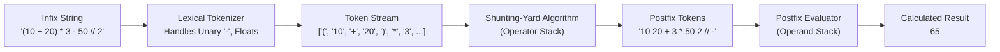
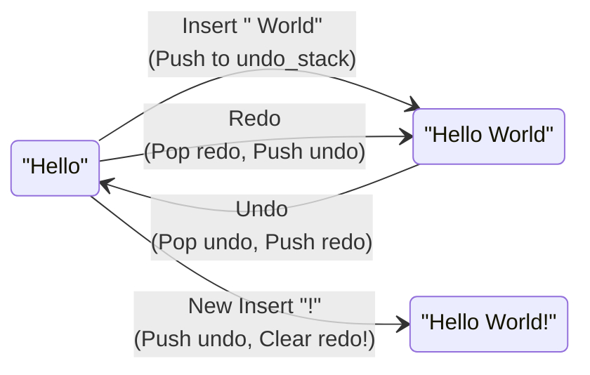

# IC-307D: Data Structures and Algorithms Lab
## Unit 4: Stacks (CO1)

---

## 1. Introduction to Stacks and LIFO

A **stack** is a foundational abstract data type (ADT) characterized by the **Last-In, First-Out (LIFO)** operational discipline. In a stack, all element insertions (**push**) and deletions (**pop**) are strictly constrained to a single end of the collection, designated as the **top**.

```
          +---------------+
Push ---> |    Item 3     | ---> Pop (Top of Stack)
          +---------------+
          |    Item 2     |
          +---------------+
          |    Item 1     | (Bottom of Stack)
          +---------------+
```

### The LIFO Principle
The element most recently inserted onto the stack is guaranteed to be the first element retrieved or removed. This structure mirrors real-world analogues such as a vertical spring-loaded plate dispenser in a cafeteria, a deck of cards, or an undo history log in software applications. The oldest element remains at the base ("bottom") of the stack until all preceding elements pushed above it have been systematically removed.

### Stack States and Boundaries
1. **Stack Overflow**: Occurs when an attempt is made to push an item onto a stack that has exhausted its preallocated physical or logical capacity. This condition is characteristic of static, fixed-size contiguous memory buffers.
2. **Stack Underflow**: Occurs when an attempt is made to pop or peek an item from an empty stack ($\text{size} == 0$). This constitutes a runtime boundary violation and raises an exception across all stack types.

### Implementation Paridigms
- **Static Stack**: Backed by a contiguous, fixed-capacity array. It provides predictable, bounded memory allocation and cache-friendly access, but suffers from an inflexible capacity limit that risks stack overflow.
- **Dynamic Stack**: Backed by a singly linked list. Memory is allocated on demand on the heap per node, enabling unbounded expansion limited only by available system RAM, but introducing pointer reference memory overhead ($8$ bytes per pointer on 64-bit architectures).

Stacks form the computational backbone of compiler design (syntax parsing, grammar validation, AST construction), runtime execution environments (activation frames, call stacks, recursion management), expression transformation (Infix, Postfix, Prefix conversions and evaluations), and transaction rollback architectures (Undo/Redo command stacks).

---

## 2. Aim

To study, design, implement from first principles, test, and analyze Static (fixed-capacity) and Dynamic (linked) Stacks in Python 3; to master stack-based conversion and evaluation of arithmetic expressions across Infix, Postfix, and Prefix notations with comprehensive operator precedence and associativity handling; to construct a complete Infix Expression Evaluator without utilizing built-in `eval()`; and to engineer a two-stack Undo/Redo text editing engine.

---

## 3. Learning Objectives

Upon completion of this laboratory unit, students will be able to:

1. **Implement Static Stacks**: Construct fixed-capacity array stacks enforcing LIFO semantics, manage top index tracking, and handle stack overflow and underflow conditions.
2. **Implement Dynamic Stacks**: Construct node-based linked stacks achieving $O(1)$ push, pop, and peek operations without preallocated capacity constraints.
3. **Master Expression Notations**:
   - Understand the mathematical differences between **Infix** ($A + B$), **Postfix / Reverse Polish** ($A\ B\ +$), and **Prefix / Polish** ($+\ A\ B$) notations.
   - Appreciate why parenthesis-free notations (postfix and prefix) eliminate operator ambiguity for compilers and stack machine hardware.
4. **Implement the Shunting-Yard Algorithm**:
   - Accurately model operator precedence hierarchies: Exponentiation ($4$), Multiplicative ($3$), Additive ($2$).
   - Manage operator associativity: Left-associative ($+$, $-$, $*$, $/$, $/ /$, $\%$) vs. Right-associative ($^$).
   - Enforce nested parenthesis grouping and detect mismatched delimiters.
5. **Formulate Infix-to-Prefix Conversion**:
   - Master the token stream reversal and inverted associativity logic required to convert infix expressions to prefix notation using a stack.
6. **Evaluate Postfix and Prefix Expressions**:
   - Process postfix expressions from left-to-right and prefix expressions from right-to-left using operand stacks.
   - Detect division and modulo by zero, malformed operand counts, and unbalanced expressions.
7. **Build an Infix Expression Evaluator**:
   - Implement lexical tokenization supporting multi-digit numbers, floats, and unary negation without relying on Python's `eval()` function.
8. **Engineer Dual-Stack Undo/Redo Systems**:
   - Implement the Command/Memento pattern utilizing two stacks (`undo_stack` and `redo_stack`) and enforce the history-branching invalidation rule.

---

## 4. Software Requirements

- **Programming Language**: Python 3.8+ (Standard Library)
- **Execution Shell**: GNU Bash 5.0+ / Linux CLI
- **Operating System**: Linux (Ubuntu / Debian x86_64)
- **Development Tooling**: Antigravity IDE / Terminal CLI
- **Prohibited Libraries**: Python's built-in `eval()`, `ast.literal_eval()`, or third-party parser packages are strictly prohibited. All parsing, conversion, and evaluation logic is implemented manually from first principles.

---

## 5. Experiment 1: Static Stack

### Problem Statement
Implement a fixed-capacity Stack in [static_stack.py](file:///home/jeet/Desktop/Data_structures/Lab04-Stacks/Program01-StaticStack/static_stack.py) using a Python list with preallocated slots. Support `push`, `pop`, `peek`, `display`, `is_empty`, and `is_full` operations. Prevent unauthorized memory modifications, raise explicit exceptions on Stack Overflow and Stack Underflow, and provide a menu-driven interface.

### Approach & Memory Organization
The [`StaticStack`](file:///home/jeet/Desktop/Data_structures/Lab04-Stacks/Program01-StaticStack/static_stack.py#L24) allocates an internal list of fixed size `[None] * capacity` and maintains an integer pointer `_top`:
- Empty State: `_top == -1`.
- Full State: `_top == capacity - 1`.
- Push Operation: Increments `_top` and stores the item at index `_top`.
- Pop Operation: Retrieves the item at `_top`, clears the slot to `None` (aiding garbage collection), and decrements `_top`.

```
Index:    0       1       2       3 (capacity = 4)
Buffer: [ 10  |  20   |  30   | None ]
                         ^
                       _top = 2
```

### Algorithm & Pseudocode

#### Algorithm: `push(item)`
1. If `is_full()` is True, raise `OverflowError("Stack Overflow")`.
2. Increment `_top \leftarrow _top + 1`.
3. Assign `_data[_top] \leftarrow item`.

#### Algorithm: `pop()`
1. If `is_empty()` is True, raise `IndexError("Stack Underflow")`.
2. Store `item \leftarrow _data[_top]`.
3. Assign `_data[_top] \leftarrow None`.
4. Decrement `_top \leftarrow _top - 1`.
5. Return `item`.

```text
FUNCTION push(item):
    IF _top == capacity - 1 THEN:
        THROW OverflowError
    _top = _top + 1
    _data[_top] = item
END FUNCTION

FUNCTION pop():
    IF _top == -1 THEN:
        THROW IndexError
    item = _data[_top]
    _data[_top] = None
    _top = _top - 1
    RETURN item
END FUNCTION
```

### Dry Run
Capacity = $3$:
1. `push(10)`: `_top = 0`, buffer: `[10, None, None]`.
2. `push(20)`: `_top = 1`, buffer: `[10, 20, None]`.
3. `push(30)`: `_top = 2`, buffer: `[10, 20, 30]`. `is_full() == True`.
4. `push(40)`: `_top == 2 == capacity - 1` $\implies$ **Raises `OverflowError`**.
5. `pop()`: Returns `30`, `_top = 1`, buffer: `[10, 20, None]`.

### Complexity Analysis
- **Push**: $O(1)$ time, $O(1)$ auxiliary space.
- **Pop**: $O(1)$ time, $O(1)$ auxiliary space.
- **Peek**: $O(1)$ time, $O(1)$ auxiliary space.
- **Display**: $O(n)$ time.
- **Auxiliary Space**: $O(C)$ where $C$ is the fixed preallocated capacity.

### Real-Life Applications
- Embedded hardware microcontrollers with strict, bounded physical RAM allocations.
- Fixed-size CPU call stacks in real-time operating systems (RTOS).

---

## 6. Experiment 2: Dynamic Stack

### Problem Statement
Implement a dynamically resizing Stack in [dynamic_stack.py](file:///home/jeet/Desktop/Data_structures/Lab04-Stacks/Program02-DynamicStack/dynamic_stack.py) using a manually created singly linked list. The stack must not use Python lists as underlying storage, must support `push`, `pop`, `peek`, `display`, and `is_empty`, and must grow arbitrarily without fixed capacity limits.

### Approach & Memory Organization
The [`DynamicStack`](file:///home/jeet/Desktop/Data_structures/Lab04-Stacks/Program02-DynamicStack/dynamic_stack.py#L42) maintains a reference `top` to the head node of a singly linked list composed of [`StackNode`](file:///home/jeet/Desktop/Data_structures/Lab04-Stacks/Program02-DynamicStack/dynamic_stack.py#L27) instances.
- Pushing an item dynamically creates a new node whose `next` references the existing `top`, and updates `top` to the new node.
- Popping an item retrieves `top.data` and updates `top` to `top.next`.
- Because nodes are linked dynamically on the heap, stack overflow is eliminated (bounded only by host virtual memory).

```
+------------+      +------------+      +------------+
| data: 30   | ---> | data: 20   | ---> | data: 10   | ---> None
| next: ref  |      | next: ref  |      | next: None |
+------------+      +------------+      +------------+
  ^
 top
```

### Algorithm & Pseudocode

```text
FUNCTION push(item):
    new_node = ALLOCATE StackNode(item)
    new_node.next = top
    top = new_node
    size = size + 1
END FUNCTION

FUNCTION pop():
    IF top == None THEN:
        THROW IndexError
    item = top.data
    top = top.next
    size = size - 1
    RETURN item
END FUNCTION
```

### Dry Run
1. `push(10)`: `node1(10, next=None)`, `top = node1`.
2. `push(20)`: `node2(20, next=node1)`, `top = node2`.
3. `push(30)`: `node3(30, next=node2)`, `top = node3`.
4. `peek()`: Returns `top.data = 30`.
5. `pop()`: Returns `30`, `top = node2`.

### Complexity Analysis
- **Push**: Strictly $O(1)$ time, $O(1)$ memory allocation per node.
- **Pop**: Strictly $O(1)$ time, $O(1)$ space.
- **Peek**: Strictly $O(1)$ time.
- **Display**: $O(n)$ traversal.
- **Auxiliary Space**: $O(n)$ where $n$ is current element count (no unused preallocated memory).

### Real-Life Applications
- High-level programming language runtime stacks where call depth cannot be predicted statically.
- Memory-adaptive graph search routines (Depth-First Search - DFS).

---

## 7. Experiment 3: Infix to Postfix Conversion

### Problem Statement
Implement Infix to Postfix (Reverse Polish Notation) conversion in [infix_to_postfix.py](file:///home/jeet/Desktop/Data_structures/Lab04-Stacks/Program03-InfixToPostfix/infix_to_postfix.py) using an operator stack. The program must handle multi-digit numbers, variable names, nested parentheses, and operators: `+`, `-`, `*`, `/`, `//`, `%`, and `^` (exponentiation).

### Operator Precedence and Associativity Rules

| Operator | Operation | Precedence | Associativity |
| :---: | :--- | :---: | :---: |
| `^` | Exponentiation ($a^b$) | **4** (Highest) | **Right-to-Left** |
| `*`, `/`, `//`, `%` | Multiplication, Division, Floor Div, Modulo | **3** | **Left-to-Right** |
| `+`, `-` | Addition, Subtraction | **2** (Lowest) | **Left-to-Right** |

### Approach: Shunting-Yard Algorithm
1. Operands are immediately output.
2. Left parentheses `(` are pushed unconditionally onto the operator stack.
3. When a right parenthesis `)` is encountered, operators are popped to output until the matching `(` is encountered.
4. When an operator `op1` is encountered:
   - If `op1` is **left-associative**: pop operators `op2` from stack while $\text{prec}(\text{op1}) \le \text{prec}(\text{op2})$.
   - If `op1` is **right-associative** (`^`): pop operators `op2` while $\text{prec}(\text{op1}) < \text{prec}(\text{op2})$.
   - Push `op1` onto stack.
5. Drain remaining operators to output.

### Pseudocode
```text
FUNCTION infix_to_postfix(expression):
    tokens = tokenize(expression)
    output = []
    stack = []
    FOR token IN tokens DO:
        IF is_operand(token) THEN:
            output.append(token)
        ELSE IF token == '(' THEN:
            stack.push(token)
        ELSE IF token == ')' THEN:
            WHILE stack AND stack.top != '(' DO:
                output.append(stack.pop())
            stack.pop() # Discard '('
        ELSE IF is_operator(token) THEN:
            WHILE stack AND is_operator(stack.top) AND
                  ((is_left_assoc(token) AND prec(token) <= prec(stack.top)) OR
                   (NOT is_left_assoc(token) AND prec(token) < prec(stack.top))) DO:
                output.append(stack.pop())
            stack.push(token)
    DRAIN stack TO output
    RETURN JOIN(output, " ")
END FUNCTION
```

### Dry Run
Expression: `A + B * (C ^ D - E)`:
1. `A`: Output `[A]`
2. `+`: Stack `[+]`
3. `B`: Output `[A, B]`
4. `*`: $\text{prec}(*) = 3 > \text{prec}(+) = 2$. Stack `[+, *]`
5. `(`: Stack `[+, *, (]`
6. `C`: Output `[A, B, C]`
7. `^`: Stack `[+, *, (, ^]`
8. `D`: Output `[A, B, C, D]`
9. `-`: $\text{prec}(-) = 2 < \text{prec}(^) = 4 \implies$ pop `^`. Stack `[+, *, (, -]`. Output `[A, B, C, D, ^]`
10. `E`: Output `[A, B, C, D, ^, E]`
11. `)`: Pop until `(`: pop `-`. Stack `[+, *]`. Output `[A, B, C, D, ^, E, -]`
12. Drain stack: pop `*`, pop `+`.
- **Result**: `A B C D ^ E - * +`

Right-associative exponentiation: `A ^ B ^ C`:
- `A`: Output `[A]`
- `^`: Stack `[^]`
- `B`: Output `[A, B]`
- `^`: Incoming `^` is right-associative. $\text{prec}(^) \not< \text{prec}(^)$ ($4 < 4$ is False). Push `^`. Stack `[^, ^]`.
- `C`: Output `[A, B, C]`
- Drain: Output `A B C ^ ^`. Correctly represents $A^{(B^C)}$.

### Complexity Analysis
- **Time Complexity**: $O(n)$ where $n$ is token count. Each token is pushed and popped at most once.
- **Auxiliary Space Complexity**: $O(n)$ for operator stack and output buffer.

### Real-Life Applications
- Bytecode generation in compiler backends (Java Virtual Machine JVM bytecode uses reverse Polish postfix execution).
- PostScript document printing language and Hewlett-Packard RPN financial calculators.

---

## 8. Experiment 4: Infix to Prefix Conversion

### Problem Statement
Implement Infix to Prefix (Polish Notation) conversion in [infix_to_prefix.py](file:///home/jeet/Desktop/Data_structures/Lab04-Stacks/Program04-InfixToPrefix/infix_to_prefix.py) using stack-based logic. Accurately manage inverted operator associativity and nested parentheses.

### Approach: Reversal and Modified Shunting-Yard
Directly generating prefix from infix is counter-intuitive because operators precede their operands. However, by leveraging string reversal, we can adapt Shunting-Yard:
1. **Token Reversal**: Reverse the token sequence of the infix expression.
2. **Parenthesis Swap**: Replace all `(` with `)` and all `)` with `(`.
3. **Inverted Associativity Shunting-Yard**:
   Because the expression is evaluated backward, associativity conditions are inverted:
   - For originally **Left-Associative** operators ($+$, $-$, $*$, $/$, $/ /$, $\%$): pop operators only if $\text{prec}(\text{token}) < \text{prec}(\text{stack.top})$ (strictly greater).
   - For originally **Right-Associative** operators ($^$): pop operators if $\text{prec}(\text{token}) \le \text{prec}(\text{stack.top})$ (greater or equal).
4. **Final Reversal**: Reverse the output token list to obtain the true Prefix expression.

### Pseudocode
```text
FUNCTION infix_to_prefix(expression):
    tokens = tokenize(expression)
    rev_tokens = REVERSE(tokens)
    SWAP_PARENTHESES(rev_tokens)
    
    output = []
    stack = []
    FOR token IN rev_tokens DO:
        IF is_operand(token) THEN output.append(token)
        ELSE IF token == '(' THEN stack.push(token)
        ELSE IF token == ')' THEN
            WHILE stack AND stack.top != '(' DO: output.append(stack.pop())
            stack.pop()
        ELSE IF is_operator(token) THEN:
            WHILE stack AND is_operator(stack.top) AND
                  ((is_left_assoc(token) AND prec(token) < prec(stack.top)) OR
                   (NOT is_left_assoc(token) AND prec(token) <= prec(stack.top))) DO:
                output.append(stack.pop())
            stack.push(token)
    DRAIN stack TO output
    RETURN JOIN(REVERSE(output), " ")
END FUNCTION
```

### Dry Run
Expression: `A - B - C` (left-associative subtraction):
1. Tokens: `[A, -, B, -, C]`.
2. Reverse: `[C, -, B, -, A]`.
3. Process:
   - `C`: Output `[C]`
   - `-`: Stack `[-]`
   - `B`: Output `[C, B]`
   - `-`: Incoming `-` has prec 2. Top `-` has prec 2. Since `-` is left-associative, check $\text{prec1} < \text{prec2} \implies 2 < 2$ (False). Do NOT pop! Push `-`. Stack `[-, -]`.
   - `A`: Output `[C, B, A]`.
   - Drain stack: Output `[C, B, A, -, -]`.
4. Reverse output: `[- , -, A, B, C]`.
- **Result**: `- - A B C` (represents `(A - B) - C`).

Expression: `A ^ B ^ C` (right-associative exponentiation):
1. Reverse: `[C, ^, B, ^, A]`.
2. `C`: Output `[C]`. `^`: Stack `[^]`. `B`: Output `[C, B]`.
3. `^`: Incoming `^` (prec 4). Top has prec 4. Right-associative checks $\text{prec1} \le \text{prec2} \implies 4 \le 4$ (True). Pop `^` to output! Output `[C, B, ^]`. Push incoming `^`.
4. `A`: Output `[C, B, ^, A]`. Drain: `[C, B, ^, A, ^]`.
5. Reverse output: `[^, A, ^, B, C]`.
- **Result**: `^ A ^ B C` (represents `A ^ (B ^ C)`).

### Complexity Analysis
- **Time Complexity**: $O(n)$ (linear token reversal and Shunting-Yard).
- **Auxiliary Space Complexity**: $O(n)$ for token buffers and stack.

### Real-Life Applications
- LISP and Scheme programming language syntax trees (S-expressions: `(+ 2 (* 3 4))`).
- Abstract Syntax Tree (AST) prefix serialization in compiler analysis passes.

---

## 9. Experiment 5: Postfix Evaluation

### Problem Statement
Implement Postfix Expression Evaluation in [postfix_evaluation.py](file:///home/jeet/Desktop/Data_structures/Lab04-Stacks/Program05-PostfixEvaluation/postfix_evaluation.py) using an operand stack. The program must evaluate space-delimited postfix expressions containing integers, floating-point numbers, negative values, and operators `+`, `-`, `*`, `/`, `//`, `%`, and `^`.

### Approach
Postfix expressions eliminate all precedence ambiguities and parentheses.
1. Scan tokens from **left to right**.
2. If token is a number: push its numeric value onto the operand stack.
3. If token is an operator:
   - Pop $b = \text{pop}()$ (right operand).
   - Pop $a = \text{pop}()$ (left operand).
   - Compute $\text{result} = a\ (\text{op})\ b$.
   - Push $\text{result}$ back onto the stack.
4. If stack contains fewer than 2 operands when an operator is encountered, raise `ValueError` (Insufficient Operands).
5. At the end, exactly one value must remain on the stack.

### Pseudocode
```text
FUNCTION evaluate_postfix(expression):
    tokens = SPLIT(expression)
    stack = []
    FOR token IN tokens DO:
        IF is_number(token) THEN:
            stack.push(parse_number(token))
        ELSE IF is_operator(token) THEN:
            IF length(stack) < 2 THEN THROW ValueError
            b = stack.pop()
            a = stack.pop()
            IF token IN ('/', '//', '%') AND b == 0 THEN THROW ZeroDivisionError
            result = apply_operator(token, a, b)
            stack.push(result)
    IF length(stack) != 1 THEN THROW ValueError
    RETURN stack.pop()
END FUNCTION
```

### Dry Run
Expression: `10 20 + 3 *`:
- `10`: Stack `[10]`
- `20`: Stack `[10, 20]`
- `+`: Pop $b = 20, a = 10 \implies 10 + 20 = 30$. Stack `[30]`
- `3`: Stack `[30, 3]`
- `*`: Pop $b = 3, a = 30 \implies 30 \times 3 = 90$. Stack `[90]`
- **Result**: `90`.

### Complexity Analysis
- **Time Complexity**: $O(n)$ where $n$ is token count.
- **Auxiliary Space Complexity**: $O(n)$ for operand stack.

### Real-Life Applications
- Stack machine hardware architectures (e.g., Forth processors, Java Virtual Machine).
- PDF rendering engines for vector mathematics and coordinate calculations.

---

## 10. Experiment 6: Prefix Evaluation

### Problem Statement
Implement Prefix Expression Evaluation in [prefix_evaluation.py](file:///home/jeet/Desktop/Data_structures/Lab04-Stacks/Program06-PrefixEvaluation/prefix_evaluation.py) using an operand stack. The program must evaluate prefix expressions with full error handling and division-by-zero checks.

### Approach
Prefix expressions place operators prior to operands. Evaluation proceeds from **right to left**:
1. Scan tokens in reverse order (from rightmost token to leftmost).
2. If token is a number: push onto the operand stack.
3. If token is an operator:
   - Pop $a = \text{pop}()$ (**First popped is the LEFT operand**).
   - Pop $b = \text{pop}()$ (**Second popped is the RIGHT operand**).
   - Compute $\text{result} = a\ (\text{op})\ b$.
   - Push $\text{result}$ onto the stack.
4. When scan completes, exactly one numeric result must remain.

### Pseudocode
```text
FUNCTION evaluate_prefix(expression):
    tokens = SPLIT(expression)
    stack = []
    FOR token IN REVERSE(tokens) DO:
        IF is_number(token) THEN:
            stack.push(parse_number(token))
        ELSE IF is_operator(token) THEN:
            IF length(stack) < 2 THEN THROW ValueError
            a = stack.pop() # Left operand
            b = stack.pop() # Right operand
            IF token IN ('/', '//', '%') AND b == 0 THEN THROW ZeroDivisionError
            result = apply_operator(token, a, b)
            stack.push(result)
    IF length(stack) != 1 THEN THROW ValueError
    RETURN stack.pop()
END FUNCTION
```

### Dry Run
Expression: `* + 10 20 3` (represents `(10 + 20) * 3`):
1. Reverse token scan: `3`, `20`, `10`, `+`, `*`.
2. `3`: Stack `[3]`
3. `20`: Stack `[3, 20]`
4. `10`: Stack `[3, 20, 10]`
5. `+`: Pop $a = 10$, pop $b = 20 \implies 10 + 20 = 30$. Stack `[3, 30]`.
6. `*`: Pop $a = 30$, pop $b = 3 \implies 30 \times 3 = 90$. Stack `[90]`.
- **Result**: `90`.

### Complexity Analysis
- **Time Complexity**: $O(n)$ linear scan.
- **Auxiliary Space Complexity**: $O(n)$ for operand stack.

### Real-Life Applications
- Abstract Syntax Tree evaluators in functional language interpreters.
- Polish notation command interfaces in scientific CAD software.

---

## 11. Experiment 7: Expression Evaluator

### Problem Statement
Construct a complete, end-to-end Infix Expression Evaluator in [expression_evaluator.py](file:///home/jeet/Desktop/Data_structures/Lab04-Stacks/Program07-ExpressionEvaluator/expression_evaluator.py). The program must accept raw arithmetic strings, perform lexical tokenization (resolving multi-digit numbers, floats, and unary negation), convert to Postfix, and evaluate the postfix expression using stacks without using `eval()`.

### Lexical Tokenization & Unary Minus Resolution
A significant challenge in arithmetic parsing is distinguishing the subtraction operator from unary negation (e.g., `-5 + 10` vs. `10 - 5` vs. `3 * -2` vs. `-(4 + 2)`).
- **Unary Minus Rule**: A `-` character is unary if it occurs at index 0 or immediately follows an operator (`+`, `-`, `*`, `/`, `//`, `%`, `^`) or an open parenthesis `(`.
- **Resolution**:
  - If immediately followed by a digit or `.`, it is tokenized as a negative numeric literal (e.g. `"-5"`, `"-3.14"`).
  - If followed by a parenthesis `(`, it is transformed into `0 - (...)` by injecting tokens `"0"` and `"-"`.

### Architecture Pipeline



### Complexity Analysis
- **Tokenization**: $O(n)$ time.
- **Infix to Postfix**: $O(n)$ time and $O(n)$ space.
- **Postfix Evaluation**: $O(n)$ time and $O(n)$ space.
- **Total Pipeline**: $O(n)$ time, $O(n)$ auxiliary space.

### Real-Life Applications
- Spreadsheet formula computation engines (Microsoft Excel, Google Sheets formula parsers).
- Database query WHERE clause boolean/arithmetic condition evaluators.

---

## 12. Experiment 8: Undo/Redo Text Editor

### Problem Statement
Develop an interactive text editor engine with Undo and Redo features in [undo_redo.py](file:///home/jeet/Desktop/Data_structures/Lab04-Stacks/Program08-UndoRedo/undo_redo.py) using the Command / Memento pattern backed by two stacks (`undo_stack` and `redo_stack`).

### Dual-Stack Undo/Redo Architecture
To provide robust undo/redo capabilities, two independent LIFO stacks collaborate:
1. **`undo_stack`**: Stores previous document states. Prior to executing any mutating command (`insert_text`, `delete_text`, `clear_text`), a snapshot of `current_text` is pushed onto `undo_stack`.
2. **`redo_stack`**: Stores undone states. When an undo occurs, `current_text` is pushed onto `redo_stack`, and the state is restored from `undo_stack`.
3. **The History-Branching Invalidation Rule**: Whenever the user performs a **new edit** after an undo, the redo history is rendered obsolete and must be **completely cleared** (`redo_stack.clear()`). This prevents divergent document timelines.



### Algorithm Operations

#### 1. Mutating Edit (`insert_text`, `delete_text`):
1. Push `current_text` to `undo_stack`.
2. Clear `redo_stack` (`redo_stack.clear()`).
3. Apply mutation to `current_text`.

#### 2. Undo (`undo`):
1. If `undo_stack` is empty, return `False`.
2. Push `current_text` to `redo_stack`.
3. Pop `current_text \leftarrow undo_stack.pop()`.
4. Return `True`.

#### 3. Redo (`redo`):
1. If `redo_stack` is empty, return `False`.
2. Push `current_text` to `undo_stack`.
3. Pop `current_text \leftarrow redo_stack.pop()`.
4. Return `True`.

### Complexity Analysis
- **Insert / Delete**: $O(k)$ string copy time, $O(k)$ space per snapshot.
- **Undo**: $O(1)$ stack pop, $O(1)$ pointer update.
- **Redo**: $O(1)$ stack pop, $O(1)$ pointer update.
- **Auxiliary Space**: $O(S \times L)$ where $S$ is number of saved states and $L$ is average string length.

### Real-Life Applications
- Integrated Development Environments (IDEs like VS Code, IntelliJ IDEA) and graphics packages (Photoshop history states).
- Database transaction rollback journals and savepoints.

---

## 13. Comparison of Static and Dynamic Stacks

| Feature | Static Stack (Array-Based) | Dynamic Stack (Linked List-Based) |
| :--- | :--- | :--- |
| **Underlying Storage** | Contiguous fixed array (`List[None] * C`) | Singly linked list (`StackNode` heap nodes) |
| **Capacity Bound** | Bounded by fixed `capacity` upfront | Unbounded; dynamically allocated on demand |
| **Stack Overflow Risk** | **Yes** — occurs when pushed items exceed capacity | **No** — constrained only by host RAM |
| **Stack Underflow Risk** | **Yes** — occurs on popping an empty stack | **Yes** — occurs on popping an empty stack |
| **Push Time Complexity** | $O(1)$ constant time | $O(1)$ constant time |
| **Pop Time Complexity** | $O(1)$ constant time | $O(1)$ constant time |
| **Memory Allocation** | Allocated once upfront; memory is pre-committed | Allocated incrementally per node |
| **Memory Overhead** | Unused allocated slots waste memory | Pointer reference overhead per node ($8$ bytes) |
| **Cache Locality** | **Superior** — contiguous memory prefetching | **Poorer** — scattered heap memory allocations |
| **Primary Use Cases** | Embedded systems, microcontrollers, real-time kernels | Compilers, user applications, unpredictable recursion |

---

## 14. Operator Precedence and Associativity

### Mathematical Precedence Hierarchy

In an arithmetic expression, **precedence** dictates the binding strength of operators in the absence of parentheses. When operators share identical precedence, **associativity** dictates the direction of evaluation:

1. **Left-to-Right Associativity (Left-Associative)**:
   $$A - B - C \implies (A - B) - C$$
   $$100 / 4 * 2 \implies (100 / 4) * 2 = 50$$
2. **Right-to-Left Associativity (Right-Associative)**:
   $$A \text{ \textasciicircum } B \text{ \textasciicircum } C \implies A \text{ \textasciicircum } (B \text{ \textasciicircum } C)$$
   $$2 \text{ \textasciicircum } 3 \text{ \textasciicircum } 2 \implies 2 \text{ \textasciicircum } (3^2) = 2^9 = 512 \quad (\neq (2^3)^2 = 64)$$

### Precedence Table

| Precedence Level | Operators | Description | Associativity | Shunting-Yard Pop Rule |
| :---: | :---: | :--- | :---: | :--- |
| **4** (Highest) | `^` | Exponentiation ($a^b$) | **Right-to-Left** | Pop if $\text{prec}(\text{token}) < \text{prec}(\text{top})$ |
| **3** | `*`, `/`, `//`, `%` | Multiply, Divide, Floor Div, Modulo | **Left-to-Right** | Pop if $\text{prec}(\text{token}) \le \text{prec}(\text{top})$ |
| **2** | `+`, `-` | Addition, Subtraction | **Left-to-Right** | Pop if $\text{prec}(\text{token}) \le \text{prec}(\text{top})$ |
| **1** (Lowest) | `(` | Left Parenthesis (delimiter) | N/A | Pushed unconditionally |

---

## 15. Algorithm and Pseudocode for Each Experiment

### Experiment 1: Static Stack Operations
```text
CLASS StaticStack:
    CONSTRUCTOR(cap):
        capacity = cap
        data = ARRAY OF SIZE cap (INITIALIZED TO None)
        top = -1

    METHOD push(item):
        IF top == capacity - 1 THEN THROW OverflowError
        top = top + 1
        data[top] = item

    METHOD pop():
        IF top == -1 THEN THROW IndexError
        val = data[top]; data[top] = None; top = top - 1
        RETURN val

    METHOD peek():
        IF top == -1 THEN THROW IndexError
        RETURN data[top]
```

### Experiment 2: Dynamic Stack Operations
```text
CLASS DynamicStack:
    CONSTRUCTOR():
        top = None
        size = 0

    METHOD push(item):
        node = ALLOCATE StackNode(item)
        node.next = top
        top = node
        size = size + 1

    METHOD pop():
        IF top == None THEN THROW IndexError
        val = top.data
        top = top.next
        size = size - 1
        RETURN val
```

### Experiment 3: Infix to Postfix Algorithm
```text
FUNCTION infix_to_postfix(tokens):
    output = [], stack = []
    FOR t IN tokens:
        IF is_operand(t): output.append(t)
        ELSE IF t == '(': stack.push(t)
        ELSE IF t == ')':
            WHILE stack.top != '(': output.append(stack.pop())
            stack.pop() # Discard '('
        ELSE:
            WHILE stack AND is_op(stack.top) AND
                  ((is_left(t) AND prec(t) <= prec(stack.top)) OR
                   (is_right(t) AND prec(t) < prec(stack.top))):
                output.append(stack.pop())
            stack.push(t)
    DRAIN stack TO output
    RETURN output
```

### Experiment 4: Infix to Prefix Algorithm
```text
FUNCTION infix_to_prefix(tokens):
    rev = REVERSE(tokens)
    SWAP_PARENTHESES(rev)
    output = [], stack = []
    FOR t IN rev:
        IF is_operand(t): output.append(t)
        ELSE IF t == '(': stack.push(t)
        ELSE IF t == ')':
            WHILE stack.top != '(': output.append(stack.pop())
            stack.pop()
        ELSE:
            WHILE stack AND is_op(stack.top) AND
                  ((is_left(t) AND prec(t) < prec(stack.top)) OR
                   (is_right(t) AND prec(t) <= prec(stack.top))):
                output.append(stack.pop())
            stack.push(t)
    DRAIN stack TO output
    RETURN REVERSE(output)
```

### Experiment 5: Postfix Evaluation
```text
FUNCTION eval_postfix(tokens):
    stack = []
    FOR t IN tokens:
        IF is_num(t): stack.push(parse(t))
        ELSE:
            b = stack.pop(), a = stack.pop()
            stack.push(apply(t, a, b))
    RETURN stack.pop()
```

### Experiment 6: Prefix Evaluation
```text
FUNCTION eval_prefix(tokens):
    stack = []
    FOR t IN REVERSE(tokens):
        IF is_num(t): stack.push(parse(t))
        ELSE:
            a = stack.pop(), b = stack.pop()
            stack.push(apply(t, a, b))
    RETURN stack.pop()
```

### Experiment 7: Complete Infix Evaluator
```text
FUNCTION evaluate(expr):
    tokens = tokenize(expr)
    postfix = infix_to_postfix(tokens)
    RETURN eval_postfix(postfix)
```

### Experiment 8: Dual-Stack Undo/Redo
```text
CLASS UndoRedoEditor:
    METHOD insert(text):
        undo_stack.push(current_text)
        redo_stack.clear()
        current_text = current_text + text

    METHOD undo():
        IF undo_stack IS EMPTY: RETURN False
        redo_stack.push(current_text)
        current_text = undo_stack.pop()
        RETURN True

    METHOD redo():
        IF redo_stack IS EMPTY: RETURN False
        undo_stack.push(current_text)
        current_text = redo_stack.pop()
        RETURN True
```

---

## 16. Dry Runs

### Dry Run 1: Infix to Postfix Conversion
Expression: `10 + 20 * (30 ^ 2)`:
1. `10`: Output `['10']`.
2. `+`: Stack `['+']`.
3. `20`: Output `['10', '20']`.
4. `*`: $\text{prec}(*) = 3 > \text{prec}(+) = 2 \implies$ Stack `['+', '*']`.
5. `(`: Stack `['+', '*', '(']`.
6. `30`: Output `['10', '20', '30']`.
7. `^`: Stack `['+', '*', '(', '^']`.
8. `2`: Output `['10', '20', '30', '2']`.
9. `)`: Pop until `(`: pop `^`. Discard `(`. Stack `['+', '*']`. Output `['10', '20', '30', '2', '^']`.
10. End of string: Pop `*`, pop `+`.
- **Result**: `10 20 30 2 ^ * +`

### Dry Run 2: Postfix Evaluation
Evaluating: `10 20 30 2 ^ * +`:
1. Push `10`: Stack `[10]`
2. Push `20`: Stack `[10, 20]`
3. Push `30`: Stack `[10, 20, 30]`
4. Push `2`: Stack `[10, 20, 30, 2]`
5. Op `^`: Pop $b = 2$, pop $a = 30 \implies 30^2 = 900$. Push `900`. Stack `[10, 20, 900]`.
6. Op `*`: Pop $b = 900$, pop $a = 20 \implies 20 \times 900 = 18000$. Push `18000`. Stack `[10, 18000]`.
7. Op `+`: Pop $b = 18000$, pop $a = 10 \implies 10 + 18000 = 18010$. Push `18010`. Stack `[18010]`.
- **Final Result**: `18010`.

---

## 17. Time and Space Complexity

### Master Operations Complexity Matrix

| Program / Operation | Best-Case Time | Average-Case Time | Worst-Case Time | Auxiliary Space |
| :--- | :---: | :---: | :---: | :---: |
| **Static Stack `push()`** | $O(1)$ | $O(1)$ | $O(1)$ | $O(1)$ |
| **Static Stack `pop()`** | $O(1)$ | $O(1)$ | $O(1)$ | $O(1)$ |
| **Static Stack `peek()`** | $O(1)$ | $O(1)$ | $O(1)$ | $O(1)$ |
| **Dynamic Stack `push()`** | $O(1)$ | $O(1)$ | $O(1)$ | $O(1)$ per node |
| **Dynamic Stack `pop()`** | $O(1)$ | $O(1)$ | $O(1)$ | $O(1)$ |
| **Infix to Postfix Conversion** | $O(n)$ | $O(n)$ | $O(n)$ | $O(n)$ |
| **Infix to Prefix Conversion** | $O(n)$ | $O(n)$ | $O(n)$ | $O(n)$ |
| **Postfix Evaluation** | $O(n)$ | $O(n)$ | $O(n)$ | $O(n)$ |
| **Prefix Evaluation** | $O(n)$ | $O(n)$ | $O(n)$ | $O(n)$ |
| **Complete Expression Evaluator**| $O(n)$ | $O(n)$ | $O(n)$ | $O(n)$ |
| **Undo / Redo Action** | $O(1)$ | $O(1)$ | $O(1)$ | $O(k)$ per state |

---

## 18. Testing and Sample I/O

All eight programs were executed and verified against normal, boundary, and error cases:

### Experiment 1: Static Stack
```text
$ python3 Lab04-Stacks/Program01-StaticStack/static_stack.py --test
=================================================================
RUNNING COMPREHENSIVE TESTS: Static Stack (Program 01)
=================================================================
  [Test 01 Passed] Caught non-positive capacity.
  [Test 02 Passed] Caught pop underflow: Stack Underflow: Cannot pop from an empty stack.
  [Test 03 Passed] Caught peek underflow: Stack Underflow: Cannot peek into an empty stack.
  [Test 04 Passed] Push and peek operations verified.
  [Test 05 Passed] Caught push overflow: Stack Overflow: Cannot push onto full stack (Capacity: 3).
  [Test 06 Passed] Strict LIFO pop order verified.
  [Test 07 Passed] Post-underflow push/pop reuse verified.

All Program 01 automated tests PASSED successfully!
```

### Experiment 2: Dynamic Stack
```text
$ python3 Lab04-Stacks/Program02-DynamicStack/dynamic_stack.py --test
=================================================================
RUNNING COMPREHENSIVE TESTS: Dynamic Stack (Program 02)
=================================================================
  [Test 01 Passed] Caught pop underflow: Stack Underflow: Cannot pop from an empty dynamic stack.
  [Test 02 Passed] Caught peek underflow: Stack Underflow: Cannot peek into an empty dynamic stack.
  [Test 03 Passed] Dynamic stack growth and peek verified.
  [Test 04 Passed] Strict LIFO pop sequence verified.
  [Test 05 Passed] Dynamic re-growth after emptying verified.

All Program 02 automated tests PASSED successfully!
```

### Experiment 3: Infix to Postfix Conversion
```text
$ python3 Lab04-Stacks/Program03-InfixToPostfix/infix_to_postfix.py --test
=================================================================
RUNNING COMPREHENSIVE TESTS: Infix to Postfix (Program 03)
=================================================================
  [Passed] 'A + B * C' -> 'A B C * +'
  [Passed] 'A * B + C' -> 'A B * C +'
  [Passed] '(A + B) * C' -> 'A B + C *'
  [Passed] 'A - B - C' -> 'A B - C -'
  [Passed] 'A ^ B ^ C' -> 'A B C ^ ^'
  [Passed] 'A ^ B ^ C ^ D' -> 'A B C D ^ ^ ^'
  [Passed] 'A // B + C % D' -> 'A B // C D % +'
  [Passed] '100 + 200 * 30' -> '100 200 30 * +'
  [Passed] 'A + B * (C ^ D - E) ^ (F + G * H) - I' -> 'A B C D ^ E - F G H * + ^ * + I -'
  [Passed] '((A + B) * (C - D)) // (E ^ F)' -> 'A B + C D - * E F ^ //'

  Testing Error Detection:
  [Passed] Caught unclosed parenthesis: Mismatched parentheses: Unclosed opening parenthesis '('.
  [Passed] Caught extraneous parenthesis: Mismatched parentheses: Extraneous closing parenthesis ')'.
  [Passed] Caught invalid character: Unrecognized character in expression: '@' at index 4

All Program 03 automated tests PASSED successfully!
```

### Experiment 4: Infix to Prefix Conversion
```text
$ python3 Lab04-Stacks/Program04-InfixToPrefix/infix_to_prefix.py --test
=================================================================
RUNNING COMPREHENSIVE TESTS: Infix to Prefix (Program 04)
=================================================================
  [Passed] 'A + B * C' -> '+ A * B C'
  [Passed] 'A * B + C' -> '+ * A B C'
  [Passed] '(A + B) * C' -> '* + A B C'
  [Passed] 'A * (B + C)' -> '* A + B C'
  [Passed] 'A - B - C' -> '- - A B C'
  [Passed] 'A - (B - C)' -> '- A - B C'
  [Passed] 'A ^ B ^ C' -> '^ A ^ B C'
  [Passed] '(A ^ B) ^ C' -> '^ ^ A B C'
  [Passed] '(A + B) * (C - D)' -> '* + A B - C D'
  [Passed] 'A // B + C % D' -> '+ // A B % C D'
  [Passed] '100 + 200 * 30' -> '+ 100 * 200 30'
  [Passed] '((A + B) * C) - (D // (E ^ F))' -> '- * + A B C // D ^ E F'

  Testing Error Detection:
  [Passed] Caught unclosed parenthesis: Mismatched parentheses: Extraneous parenthesis.
  [Passed] Caught extraneous parenthesis: Mismatched parentheses: Unclosed parenthesis.

All Program 04 automated tests PASSED successfully!
```

### Experiment 5: Postfix Evaluation
```text
$ python3 Lab04-Stacks/Program05-PostfixEvaluation/postfix_evaluation.py --test
=================================================================
RUNNING COMPREHENSIVE TESTS: Postfix Evaluation (Program 05)
=================================================================
  [Passed] '10 20 +' = 30
  [Passed] '50 20 -' = 30
  [Passed] '6 7 *' = 42
  [Passed] '100 4 /' = 25
  [Passed] '17 5 //' = 3
  [Passed] '17 5 %' = 2
  [Passed] '2 3 ^' = 8
  [Passed] '10 20 + 3 *' = 90
  [Passed] '10 20 3 * +' = 70
  [Passed] '2 3 2 ^ ^' = 512
  [Passed] '-5 3 +' = -2
  [Passed] '10 -2 *' = -20
  [Passed] '2.5 4.0 *' = 10
  [Passed] '7.5 2.5 -' = 5
  [Passed] '15 -3 //' = -5
  [Passed] '15 7 1 1 + - / 3 * 2 1 1 + + -' = 5

  Testing Error Detection:
  [Passed] Caught division by zero: Division by zero in '/' operation.
  [Passed] Caught floor division by zero: Division by zero in '//' floor division.
  [Passed] Caught modulo by zero: Modulo by zero in '%' operation.
  [Passed] Caught insufficient operands: Malformed postfix expression: Insufficient operands for operator '+'.
  [Passed] Caught excess operands: Malformed postfix expression: Too many operands without operators (Stack: [5, 7]).

All Program 05 automated tests PASSED successfully!
```

### Experiment 6: Prefix Evaluation
```text
$ python3 Lab04-Stacks/Program06-PrefixEvaluation/prefix_evaluation.py --test
=================================================================
RUNNING COMPREHENSIVE TESTS: Prefix Evaluation (Program 06)
=================================================================
  [Passed] '+ 10 20' = 30
  [Passed] '- 50 20' = 30
  [Passed] '* 6 7' = 42
  [Passed] '/ 100 4' = 25
  [Passed] '// 17 5' = 3
  [Passed] '% 17 5' = 2
  [Passed] '^ 2 3' = 8
  [Passed] '* + 10 20 3' = 90
  [Passed] '+ 10 * 20 3' = 70
  [Passed] '^ 2 ^ 3 2' = 512
  [Passed] '+ -5 3' = -2
  [Passed] '* 10 -2' = -20
  [Passed] '* 2.5 4.0' = 10
  [Passed] '- 7.5 2.5' = 5
  [Passed] '// 15 -3' = -5
  [Passed] '- * / 15 - 7 + 1 1 3 + 2 + 1 1' = 5

  Testing Error Detection:
  [Passed] Caught division by zero: Division by zero in '/' operation.
  [Passed] Caught floor division by zero: Division by zero in '//' floor division.
  [Passed] Caught modulo by zero: Modulo by zero in '%' operation.
  [Passed] Caught insufficient operands: Malformed prefix expression: Insufficient operands for operator '+'.
  [Passed] Caught excess operands: Malformed prefix expression: Too many operands without operators (Stack: [3, 9]).

All Program 06 automated tests PASSED successfully!
```

### Experiment 7: Complete Expression Evaluator
```text
$ python3 Lab04-Stacks/Program07-ExpressionEvaluator/expression_evaluator.py --test
=================================================================
RUNNING COMPREHENSIVE TESTS: Expression Evaluator (Program 07)
=================================================================
  [Passed] '10 + 20 * 3' = 70
  [Passed] '(10 + 20) * 3' = 90
  [Passed] '50 - 20 - 10' = 20
  [Passed] '100 / 4 * 2' = 50
  [Passed] '17 // 5 + 17 % 5' = 5
  [Passed] '2 ^ 3 ^ 2' = 512
  [Passed] '(2 ^ 3) ^ 2' = 64
  [Passed] '2.5 * 4.0 + 1.5' = 11.5
  [Passed] '15.5 - 5.5' = 10
  [Passed] '-5 + 15' = 10
  [Passed] '3 * -4' = -12
  [Passed] '-(4 + 2) * 3' = -18
  [Passed] '10 - -5' = 15
  [Passed] '((15 / (7 - (1 + 1))) * 3) - (2 + (1 + 1))' = 5
  [Passed] '(10 + 20) * 3 - 50 // 2' = 65

  Testing Error Detection:
  [Passed] Caught division by zero: Division by zero in '/' operation.
  [Passed] Caught missing ')': Mismatched parentheses: Missing matching closing ')'.
  [Passed] Caught extraneous ')': Mismatched parentheses: Missing matching opening '('.
  [Passed] Caught malformed operator sequence: Malformed expression: Insufficient operands for operator '+'.

All Program 07 automated tests PASSED successfully!
```

### Experiment 8: Undo/Redo Text Editor
```text
$ python3 Lab04-Stacks/Program08-UndoRedo/undo_redo.py --test
=================================================================
RUNNING COMPREHENSIVE TESTS: Undo/Redo Editor (Program 08)
=================================================================
  [Test 01 Passed] Initialized empty editor and empty stack handling.
  [Test 02 Passed] Text insertion and undo stack tracking verified.
  [Test 03 Passed] Text deletion and snapshot verified.
  [Test 04 Passed] Multi-level sequential undo verified.
  [Test 05 Passed] Multi-level sequential redo verified.
  [Test 06 Passed] Branching edit clears redo history verified.
  [Test 07 Passed] Clear operation and recovery via undo verified.

All Program 08 automated tests PASSED successfully!
```

---

## 19. Real-Life Applications

1. **Compilers and Runtime Interpreters**:
   - Call stack allocation: function frames, local variables, and return instruction pointers.
   - Syntax parsers and context-free grammar pushdown automata (PDA).
2. **Expression Evaluation & Calculator Engines**:
   - Scientific computing packages and financial calculators evaluating complex mathematical formulas without variable ambiguities.
3. **Software Productivity Suites (Undo/Redo)**:
   - Text editors (VS Code, Word), graphic design tools (Photoshop, Illustrator), and CAD software managing user action histories.
4. **Web Browser Navigation**:
   - Dual-stack "Back" and "Forward" tab navigation history.
5. **Syntax and Tag Matching**:
   - XML/HTML tag validators, JSON parsers, and code linters checking matching brackets `()`, `[]`, `{}`.
6. **Backtracking Algorithms**:
   - Maze solving, 8-Queens puzzle, knight's tour, and Depth-First Search (DFS) in graph algorithms.

---

## 20. Folder Structure

```text
Lab04-Stacks/
├── Program01-StaticStack/
│   └── static_stack.py
├── Program02-DynamicStack/
│   └── dynamic_stack.py
├── Program03-InfixToPostfix/
│   └── infix_to_postfix.py
├── Program04-InfixToPrefix/
│   └── infix_to_prefix.py
├── Program05-PostfixEvaluation/
│   └── postfix_evaluation.py
├── Program06-PrefixEvaluation/
│   └── prefix_evaluation.py
├── Program07-ExpressionEvaluator/
│   └── expression_evaluator.py
├── Program08-UndoRedo/
│   └── undo_redo.py
├── README.md
└── reflection.md
```

---

## 21. Execution Instructions

All eight programs are executable independently from the repository root:

```bash
# 1. Static Stack (Program 01)
python3 Lab04-Stacks/Program01-StaticStack/static_stack.py --test
python3 Lab04-Stacks/Program01-StaticStack/static_stack.py

# 2. Dynamic Stack (Program 02)
python3 Lab04-Stacks/Program02-DynamicStack/dynamic_stack.py --test
python3 Lab04-Stacks/Program02-DynamicStack/dynamic_stack.py

# 3. Infix to Postfix Conversion (Program 03)
python3 Lab04-Stacks/Program03-InfixToPostfix/infix_to_postfix.py --test
python3 Lab04-Stacks/Program03-InfixToPostfix/infix_to_postfix.py

# 4. Infix to Prefix Conversion (Program 04)
python3 Lab04-Stacks/Program04-InfixToPrefix/infix_to_prefix.py --test
python3 Lab04-Stacks/Program04-InfixToPrefix/infix_to_prefix.py

# 5. Postfix Evaluation (Program 05)
python3 Lab04-Stacks/Program05-PostfixEvaluation/postfix_evaluation.py --test
python3 Lab04-Stacks/Program05-PostfixEvaluation/postfix_evaluation.py

# 6. Prefix Evaluation (Program 06)
python3 Lab04-Stacks/Program06-PrefixEvaluation/prefix_evaluation.py --test
python3 Lab04-Stacks/Program06-PrefixEvaluation/prefix_evaluation.py

# 7. Complete Expression Evaluator (Program 07)
python3 Lab04-Stacks/Program07-ExpressionEvaluator/expression_evaluator.py --test
python3 Lab04-Stacks/Program07-ExpressionEvaluator/expression_evaluator.py

# 8. Undo/Redo Text Editor (Program 08)
python3 Lab04-Stacks/Program08-UndoRedo/undo_redo.py --test
python3 Lab04-Stacks/Program08-UndoRedo/undo_redo.py
```

---

## 22. Learning Outcomes

1. **Algorithmic Mastery of Stacks**: Thoroughly comprehended the LIFO principle, stack frame boundaries, and the contrasting memory dynamics of static vs. dynamic implementations.
2. **Expression Mechanics**: Understood why parentheses-free expressions (postfix and prefix) streamline machine computation by eliminating precedence ambiguity.
3. **Compiler Front-End Engineering**: Mastered Dijkstra's Shunting-Yard algorithm, including precedence tables and associativity rules for left- and right-associative operators.
4. **Parsing Robustness**: Handled multi-digit numbers, negative literals, unary minus resolution, floating-point values, and division-by-zero detection without reliance on `eval()`.
5. **Practical Application Engineering**: Designed a dual-stack Undo/Redo architecture, enforcing the history-clearing rule upon branching edits.

---

## 23. References

1. Cormen, T. H., Leiserson, C. E., Rivest, R. L., & Stein, C. *Introduction to Algorithms* (3rd ed.). MIT Press, 2009. Section 10.1: Stacks and Queues.
2. Aho, A. V., Lam, M. S., Sethi, R., & Ullman, J. D. *Compilers: Principles, Techniques, and Tools* (2nd ed.). Addison-Wesley, 2006. Chapter 2: A Simple Syntax-Directed Translator.
3. Dijkstra, E. W. *Making a Translator for ALGOL 60*. Automatic Programming Information, 1961 (Introducing the Shunting-Yard Algorithm).
4. Python Software Foundation. *Python 3 Standard Library Documentation: `sys`, `typing`, `math`*. https://docs.python.org/3/

